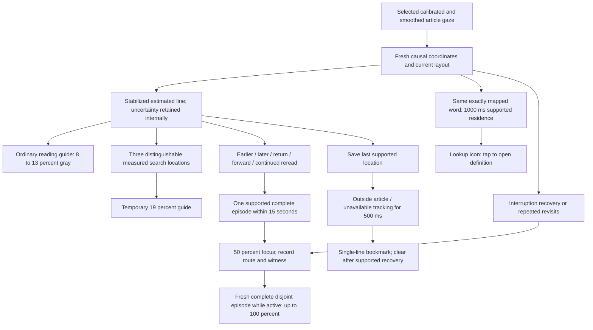

# Reading aid implementation V5

Implemented for the user's 2026-10-19 proposal. Profile: `EVIDENCE_ALIGNED_V5`.
Article, Scanpath pilot and Scanpath replay select this profile. Earlier profiles
remain available to deterministic tests; the frozen scanpath extractor is unchanged.

The default line guide and blue bookmark remain **single-line**. The earlier
automatic widening was rejected. On 2026-10-20 the owner separately approved an
explicit **Three-line guide** menu option; this optional presentation is described
below. Bookmark activation from within-article row jumps remains removed.

## Flow

## Operational rules

### Location and guide

- Consume the same selected coordinate stream as the dot. During automatic
  scrolling, stabilize body-content Y and project it into the current viewport.
- Use a trailing 150 ms median and require 150 ms of fresh row-candidate residence
  before publishing support. A duplicate capture adds no time. A gap over 250 ms,
  missing coordinates, eye closure or an operational pause breaks pending support.
- No beginning/end fraction of a line is required. Ordinary supported reading
  receives the guide without a difficulty classification.
- The default line guide highlights **one stabilized estimated row**. It never
  expands automatically into a neighbouring-row band. A single displayed row is
  the owner's chosen presentation, not a claim of validated row accuracy.
- A supplied measured error radius defines internal row uncertainty. **Current
  calibration has no saved error radius**; internal neighbouring-row bounds are
  logged as `neighboring_rows_uncertainty_unknown`, not painted. They are an
  engineering fallback, not a coverage guarantee. Jitter is not accuracy.
- Search emphasis requires three pairwise separated **measured** intervals, such
  as L5 → L7 → L6, within 8 seconds. Unknown-error input cannot activate it.
  Each new witness triple may receive 19% emphasis for 1.5 seconds.
- Gray target opacity ramps from 8% toward 13% over 1.5 seconds of the current
  supported visit. Presentation entry is 150 ms. After the last supported
  delivery: retain for 750 ms, then fade out over 300 ms. These clocks are separate.
- Reader strength caps apply. The separately selected sentence option retains
  its text-context behaviour; the default line option stays one row. Background
  spans preserve glyph color and wrapping.

### Optional three-line guide — 2026-10-20

Select **Reading aids → Three-line guide**. The same controls/runtime are used in
Article, Scanpath pilot and Replay. Single line and Sentence context remain
independent selectable alternatives; choosing this presentation does not alter
scanpath extraction, word assignment, focus rules or the single-line bookmark.

The supported estimated row occupies the first, middle or last band row as below.
The three-row target is a reader-selected visual footprint,
not a measured confidence interval or a guarantee of gaze accuracy.

| Supported direction | Example with gaze supported on L5 | Gaze row position | Uniform gray opacity |
|---|---|---|---:|
| Balanced / settled / unconfirmed | L4-L6 | Middle | 9% |
| Downward | L5-L7 | First | 9% |
| Upward | L3-L5 | Last | 9% |

This supersedes the stepped 9/13/9, 8/13/10 and 10/13/8% presentation. The owner
confirmed the separate double-alpha correction restored visibility, then found
the row stripes distracting and requested directional band position. One fill
now covers the whole band at 9%, with no internal row-color boundaries. These
settings reflect a reader-requested UI trial, not a validated optimum or benefit.

- Infer position direction after **two consecutive same-direction distinct
  supported row changes**. A first reversal returns to balanced. Repeated callbacks
  and same-row updates do not create a change. Missing/operational segments,
  layout/article changes and guide-style changes reset this history. This is an
  appearance heuristic, not a classification of normal or difficult reading.
- Recenter after **900ms of fresh supported residence on the same row after its
  confirmation**. Wall time, missing gaze and duplicate callbacks cannot add this
  support. Retain movement history so continued progression can resume direction;
  a new visit resets the settling residence basis. The 900ms value is a trial
  presentation setting, not a research-established threshold.
- Use content-row order rather than screen-Y motion, so scrolling alone does not
  change reading direction. Keep the existing selected calibrated/smoothed point
  and location-support gate; no extra dwell or smoothing is applied to measurements.
- Interpolate actual body-coordinate row boundaries and opacity targets over
  **250ms** with eased motion. Retarget from the current displayed state; repeated
  identical targets do not restart the transition. Font/spacing reflow invalidates
  old positions. A moving edge may pass across a partial fourth row; it does not
  add a second old/new band. Only the outer top and bottom edges fade, each over
  6% of the whole band height (about 18% of a row for equal-height rows).
- Reader strength limits scale the whole band using the existing
  gray-guide opacity cap. This option keeps the 9% uniform target rather than the
  single-line 8→13% residence ramp or 19% search emphasis. A reduced cap applies
  immediately even while a position/direction transition is running.
- Retain the existing **150ms entry, 750ms tracking-loss grace and 300ms exit**.
  Backgrounds are drawn behind text without changing glyph color, text offsets,
  font metrics or wrapping. At article edges, show only existing neighbors rather
  than shifting the supported anchor to manufacture three rows.
- Trace form: `CURRENT_THREE_LINE_GUIDE_GRAY_V1`. `guideRange` is the target visible
  three-row text range; `guide_support.first_line/last_line` still describe internal
  uncertainty. Direction support IDs retain their individual capture clocks;
  action capture bounds describe the current supported location. Actual positive
  render receipts require a nonzero text-background draw, not overlay eligibility.
  The article demo supplies balanced manufactured appearance only.

Independent source review found no actionable issue. All 21 focused motion/policy
JVM tests passed, and both APKs built on the first bounded attempt. Evidence:
`output/guide-directional-band-check-01/summary.json` and `build.log`.
App SHA-256: `50492bd5f1c82c83e6aa350fbc0d41e011114fdf16ca799917550808dba005c9`.
Owner approved the A56 update/native checks. Installed the matching app/test APKs
with `-r -t`, preserving app data and calibration. All six camera-free native
tests passed: four rendering tests, the Three-line menu check and balanced demo
preview. The Replay fixtures passed all
135 quantitative pixel samples across light/dark/sepia, including uniform fill,
all three directional placements, internal boundaries during fractional movement,
reader caps and retained Single-line opacities. On white, each requested band row
rendered #f4f4f4. Visually inspected DOWN, BALANCED and UP light previews: the
band is continuous and its position follows the requested anchor slot.
Evidence also includes `a56-rendering.log` and `previews/` (12 synthetic PNGs
and `samples.json`) in the checkpoint folder. Synthetic previews originate in
app cache `guide-directional-band/`. No camera, calibration or private capture
was started. Software-Canvas native results do not validate natural-reading
benefit, live gaze accuracy or hardware frame pacing. Configuration version:
`UNIFORM_DIRECTIONAL_BAND_MOTION_V5`. Prior validation below is historical;
it does not establish the usability of this new presentation.

[Niklaus et al., CHI2023](https://research.adobe.com/publication/digital-reading-rulers-evaluating-inclusively-designed-rulers-for-readers-with-dyslexia-and-without/)
evaluated digital reading rulers with 91 crowdsourced readers with dyslexia and
86 without. The publication supports investigating rulers and reader preferences;
it does **not** validate these three-line targets, direction rule, 250ms transition
or automatic phone mapping. They are prototype settings. Software checks below
can establish implementation behavior, not gaze accuracy or reading benefit.

Historical initial verification: source review found and resolved an eligibility gate that would
reject THREE_LINE actions. No remaining actionable source issue. **303 focused
aid/replay tests across 31 suites passed**, zero failures/errors/skips. Both debug
APKs built; the focused whitespace check passed. Evidence:
`output/three-line-guide-check-01/summary.json` and `build.log`. App APK SHA-256:
`c384e9d3fe12af931d9138946ec4549c31169df4768b742723a5da7bcca9ddf1`.
Native renderer/menu/demo checks compiled but did not run. No phone install,
camera activity, staging or commit. Live appearance and reading benefit remain
unverified by these software checks.

### Single-line smoothing and three-line visibility correction

Both V5/demo gray line modes use the same 250ms eased body-coordinate movement. Single
line keeps one physical-row footprint at rest and its 8→13% residence targets
(19% only with the existing measured search witness). Three-line mode uses the
more visible targets above. Row coverage is explicit; neither changes detected
reading location, uncertainty, the selected gaze stream or focus/bookmark rules.

Position and alpha transition clocks are separate so fresh residence-opacity
updates cannot restart position movement. Retarget from the current interpolated
state; apply new reader caps immediately. Existing 150ms entry, 750ms tracking-loss
grace and 300ms exit remain. Layout/font/style changes invalidate old geometry;
scroll translation reprojects content coordinates. Sentence and legacy rendering
paths are retained. Shared presentation targets now come from
`ReadingLineGuideAppearance.kt`; configuration version
`SHARED_SINGLE_THREE_LINE_MOTION_V2` identifies this change.

Independent source review found no actionable issue. **306 focused aid/replay
tests across 31 suites passed**, zero failures/errors/skips. Both debug APKs built
and the focused whitespace check passed. Evidence:
`output/line-guide-visibility-motion-check-01/summary.json` and `build.log`.
App APK SHA-256:
`2fee5e9482edd815d4bdf92e05a94cd51021fa34a76293287ab742b67f666d52`.
Native bitmap fixtures cover stronger side rows, both animated footprints and
single-line motion despite opacity refreshes; they compiled but device execution
remains pending. Live phone visibility and the cause of the reported appearance
are not established by these software checks.
No device install, camera activity, staging or commit has been performed for this
correction. The default remains Single line; choose Three-line guide explicitly
to inspect its wider footprint.

### Actual drawn opacity — 2026-10-20 correction

Owner reports that the visibility problem also occurs in Replay. The faded
guide sections applied alpha twice: the Paint color and the LinearGradient
plateau both contained the requested alpha. The shader alpha is modulated by
Paint alpha. Thus nominal Single-line 8% became about 0.6%, and a Three-line 9%
neighbor about 0.8%; its solid 13% center was unaffected. The old native tests
accepted any nonzero pixel difference and did not establish the intended opacity.

The correction keeps gradient plateaus opaque gray and applies the target alpha
once through Paint.alpha; only the outer fade changes shader alpha. Gray RGB is
preserved at transparent endpoints. No change to numerical presentation targets,
timing, support eligibility or motion is needed. Configuration version:
`SINGLE_ALPHA_BACKGROUND_MOTION_V4`.

The new native Replay check compares rendered RGB with independent alpha
compositing calculations, within two channel levels. It covers 99 row/case
combinations across light, dark and sepia backgrounds; Single-line 8/13/19%
including half entry/exit; all three directional row targets and reader caps.
It saves synthetic preview PNGs and numeric samples in app cache `guide-opacity/`.
Independent source review found no actionable issue. All 19 focused motion/policy
JVM tests passed and both APKs built. Continued the owner's approved A56
camera-free rendering verification with data/calibration preserved: **all four
native tests passed**, including all 99 quantitative row/case checks. On white,
the Single-line 8/13/19% plateaus yielded #f5f5f5/#efefef/#e7e7e7, and balanced
Three-line 9/13/9% yielded #f4f4f4/#efefef/#f4f4f4. Saved Replay previews show the
one-row and three-row footprints. These software-Canvas checks on the phone
assess rendering correctness, not gaze accuracy, hardware frame pacing, human
benefit or the cause of the separately reported FPS drop.
Evidence: `output/guide-alpha-check-01/summary.json`, `build.log`,
`a56-rendering.log` and `previews/` (six synthetic PNGs and `samples.json`).
App APK SHA-256: `44f9c29616a68e074ea777956276191adcea7ba1ed45c9100ba67e0cc64a6efa`.

### Rendering regression and gaze-dependent lag — 2026-10-20

The owner subsequently reported no visible Single line, only one apparent row in
Three-line mode, and callback FPS dropping from about 30 to 6–10 on the top
recommended article. The slowdown persisted with Reading guide disabled, followed
the top position after feed refresh, and occurred while looking at the phone.
Increasing neighbor opacity alone did not establish or resolve that report.

Source inspection identified avoidable work in the animated renderer: a full-body
LineBackgroundSpan was removed/readded every accepted update, each physical-row
draw copied the article text and checked geometry, and validation caches reset on
every update. These costs are real source properties; they do not prove the cause
of the reported camera/model or UI slowdown.

The localized replacement uses a stable body-background Drawable for animated
Single line and Three-line modes. It draws the original background, one clipped
guide band, and then lets TextView draw its glyphs. Animated guide updates preserve
the text object and Layout. Existing motion/opacity rules remain, paint and
gradients are reused, row validation is cached by Layout and immutable row-list
identity, and drawable invalidation schedules one cancellable next redraw. Source
text changes and reflow withhold stale geometry; clear/detach/body/theme changes
restore or adopt the proper background and preserve padding. Sentence/legacy spans
and bookmark/focus behavior remain separate. Android's background-before-content
ordering and background scroll handling are documented in the
[AOSP View implementation](https://android.googlesource.com/platform/frameworks/base/+/8360153/core/java/android/view/View.java);
the old per-row span behavior is visible in
[AOSP Layout](https://android.googlesource.com/platform/frameworks/base/+/master/core/java/android/text/Layout.java).

Runtime now resolves sentence ranges only when Sentence mode and the reading
guide are enabled, avoiding unused text segmentation/row validation in single-line,
three-line and guide-off modes. Configuration version:
`STABLE_SINGLE_DRAW_BACKGROUND_MOTION_V3`. This does not disable gaze processing,
alter calibration or change scanpath measurements to mask the FPS drop.

Read-only inspection of existing A56 `MGazeNetPerf` numeric messages found
face-present windows with localizer about 71–80ms and gaze-model inference about
62–103ms in one provider, versus about 24–31ms and 26–30ms in another instance of
the same process. No-face windows were about 28–31ms with no model inference.
The stages run in a pipeline; summing stage means does not give delivered FPS.
These logs are not paired article-labelled comparisons, UI frame timings or proof
of a particular cause. No camera, gaze collection or calibration was started.

Independent source review found no actionable issue. The first bounded run built
the app but stopped compiling the test APK at fixture line155: a local `val text`
shadowed TextView.text. Corrected to `this.text = body.text`; the app source is
unchanged by this test-only correction. JVM tests did not execute in that attempt.
No retry without owner approval under AGENTS.md. Evidence:
`output/guide-renderer-regression-check-01/summary.json` and `build.log`.
New native fixtures
check long-text text/Layout/background identity reuse, drawable callback invalidation,
padding, parent/internal scrolling, clipped pixels, theme/body changes and visible
one/three-row footprints.

Owner-approved retry and A56 verification: **306 focused JVM tests across 31 suites
passed**, zero failures/errors/skips; both debug APKs built. Updated the app/test
APKs on SM-A566B using `adb install -r -t`, without clearing data or changing
calibration. **All three camera-free native rendering tests passed**: row coverage,
behind-glyph drawing/motion/caps/reflow; long-text text/Layout/background reuse,
scroll/padding clipping and restoration; drawable invalidation/cancellation.
These pixel checks use software Canvas bitmaps on the actual device. They do not
measure live gaze FPS, hardware frame pacing or natural-reading visibility.
The reported gaze-dependent throughput drop remains unresolved.

Current evidence: `output/guide-renderer-regression-check-02/summary.json`,
`build.log` and `a56-rendering.log`. App SHA-256:
`f9e6833596c2e87f5b384cb897af4bcac0998bb709453bac1ca6a807bb8bb2fe`.
No camera start, recording, calibration, staging or commit in this verification.

### Word offer

- Require 1000 ms of fresh, contiguous supported residence on the same exact
  mapped word. Missing intervals, duplicates and unsettled locations add no time.
- The selected point must be inside that word's current screen rectangle, and
  its UTF-16 range must belong to the mapped row. No nearest-word expansion.
- If measured uncertainty is supplied, its entire rectangular bound must fit
  inside the word. Without that measurement, retain the existing exact mapper
  gate and log `mapping_only_unvalidated`; this is **not validated word accuracy**.
- Present the existing lookup icon. It expires after its existing 5-second offer
  lifetime. Only a tap opens the definition. Do not offer again for the same
  unresolved word, including after a brief loss and return. Supported residence
  on a different valid word resolves the earlier visit.

### Focus

- New route: stabilized A → forward first-pass rows → B → A-region → C → D, with B later than
  A and A-region < C < D ≤ B, within 15 seconds. The broad departure/return bands
  must be separate; adjacent forward reread steps use stable row order. Example:
  L4 → L7 → L4 → L5 → L6, or the ordinary first pass
  L4 → L5 → L6 → L7 → L4 → L5 → L6. Intermediate first-pass rows must progress
  forward; after the broad return, at least two supported forward row changes
  must remain within the earlier frontier. Same-row requalification after
  unsettled samples replaces its witness rather than adding a movement. Missing
  input and long gaps still break incomplete patterns. This is an **online rereading prefix**, not proof that a
  sentence was misunderstood. Traces state whether movement distinguishability
  was measured or remained unknown.
- **One complete supported broad episode within 15,000 ms activates 50% focus.**
  Require separation between its later frontier and earlier-return region, not
  between every adjacent forward reread step. Use measured uncertainty if supplied.
  With the current unknown-error +/-1-row fallback, diagnostic anchors need at
  least three rows of separation. This is a coarse safeguard, not measured accuracy.
- Preserve interruption recovery: three separately qualified unavailable/recovery
  episodes within 30 seconds make one complete qualification. Missing gaze is
  labelled tracking unavailability. Font-aware A–B–A–B repetition remains, with
  the same separated-anchor requirement. Adjacent uncertain A–B–A–B alone cannot
  activate current focus. Route IDs remain distinct in logs.
- A shared ledger across routes grants initial 50% and allows **100% only after
  a fresh complete independently qualified episode while the response is active**.
  All credited evidence must follow the previous episode's final credited capture.
  Duplicate IDs, relabelled/shared captures, double-labelled patterns and extended
  overlapping suffixes cannot escalate. Interruption escalation therefore needs
  three more complete loss/return episodes, not just a fourth return. Retain at
  most two dose witnesses. These strengths are trial settings, not a difficulty score.
- Pending row evidence is discarded on operational pause, article/layout change
  or font resize. Reflow also removes active row-based qualifications; retained
  interruption qualifications may continue. Reader caps remain in effect.
- Keep candidate-onset capture time separate from the first support-confirmation
  capture and delivery times. Ongoing updates retain those first-confirmation
  clocks. Fresh support uses the existing 150 ms residence stage; no blanket
  300 ms or speed-dependent confirmation rule was added.
- Both styles enter over 400 ms. Hold for 3 seconds of fresh **supported reading**,
  then fade over 7 seconds of supported reading. Ticks, duplicates, loss and
  unsupported transition time cannot advance recovery. Refreshes preserve recovery
  progress and do not restart a continuous presentation's onset animation.
- Target surrounding opacity is fade-text 60%/85%, or dark 40%/60%, at requested
  strengths 50%/100%; onset, recovery and reader caps reduce actual opacity.
  Retain the existing styles and maximum 85% surrounding suppression. Protect
  the reread passage plus neighbouring context during tracking and scroll holds.
  If that leaves no space to shade, legibility takes priority over a visible mask.

### Bookmark

- Save a single supported row only when it agrees with the current eligible
  line mapper. A different coarse row without that agreement invalidates an
  unshown saved source, rather than presenting a stale, apparently precise marker.
- Activate after **500 ms of outside-article gaze** (at least three fresh samples),
  or **500 ms of tracking unavailability**. Keep those two reasons distinct.
  Earlier-row and skipped-row movements **do not activate this bookmark**.
  The marker freezes at the saved line rather than following the departure.
- Minimum visibility: 1.5 seconds. Thereafter clear after 1 second of supported
  return to the saved row, or 1.5 seconds of coherent same/next-row reading elsewhere.
- Fresh article input may bridge the settling of a new row, but only supported
  capture intervals earn dismissal time. A brief glance does not clear the cue.
- Mapper-rejected observations break precise return credit. A new accepted run
  starts at its first accepted capture; earlier coarse residence cannot fill in
  rejected time. Bookmark support has its own evidence IDs in the trace.
- Clear invalid article/layout anchors; bound a cue to 30 seconds. Layout reflow
  invalidates source coordinates. Same-layout viewport translation retains the
  supported content location where applicable.

All numerical settings above are engineering/pilot choices. They are not
published optimal thresholds, confidence probabilities or evidence of benefit.
Synthetic tests establish software contracts, not reading difficulty or efficacy.

## What the cited studies actually establish

| Primary source | Findings relevant to the implementation | Limits |
|---|---|---|
| [Wang et al., 2023](https://arxiv.org/html/2303.16346), §§3–5 | Exploratory lab study with 20 low-vision and 20 sighted participants; Tobii Pro Fusion, 120 Hz, reading aloud. Measured lines searched before the next line was located and proposed line/word assistance concepts. | No trial of this aid; desktop aloud-reading findings do not validate silent phone reading, row mapping, gray opacity or timing. |
| [Hiraoka et al., 2016](https://doi.org/10.1145/2993148.2993167), [author paper](https://www.phontron.com/paper/hiraoka16icmi.pdf), §§4–6 | Ten analyzed Japanese graduate students reading English, desktop Tobii X2-30. Per-word gaze and lexical features predicted post-reading known/unknown word reports; reported F-measure 0.556 versus threshold baseline 0.422. | Small L2 sample and a word-knowledge target. No validated 1000 ms cutoff, phone word accuracy or definition-offer benefit. |
| [von der Malsburg & Vasishth, 2011](https://tmalsburg.github.io/MalsburgVasishth2011.pdf), pp.117–123 | Reanalysis of 44 participants' Spanish ambiguous-sentence data distinguished regression patterns. Whole-sentence rereading varied with manipulated syntactic conditions; short regressions were less specific. | Rereading occurred in multiple conditions. Sentence analysis does not validate this five-row online prefix or a focus intervention. |
| [Cane et al., 2012](https://doi.org/10.1080/17470218.2012.656666), [article PDF](https://www.interruptions.net/literature/Cane-QJExpPsychol12.pdf), Experiment 2 | Controlled desktop paragraph reading with EyeLink 1000 and imposed spoken-story interruptions. A highlighted interruption word aided resumption. | Supports a spatial recovery cue in that task. No evidence that missing phone gaze means forgotten location, or that our dismissal times are optimal. |

## Implementation and verification

### Preimplementation switch-confirmation review — 2026-10-20

The owner requested a challenge of the proposed replacement before implementation.
Recommendation: retain candidate/supported line states, but compare fixed support
with an experimental adaptive timing variant; do not assert that rapid switches
are error, that extra smoothed frames establish accuracy, or that this is optimal.

- Existing One-Euro smoothing, trailing median and 150ms residence already affect
  transition timing. Additional confirmation can suppress genuine brief returns.
  Counts alone give different supported spans at different frame rates. Preserve
  distinct capture times, gap limits and separate candidate-onset/confirmation times.
- If speed is calculated from confirmations, altering confirmation delays alters
  the supposed speed. Use an explicitly defined observational time basis; selected
  smoothed coordinate crossings are not measured physiological saccade onsets.
- Stable calibration offset can pass temporal support; no measured per-session
  spatial error radius is currently saved. Avoid manufacturing accuracy bounds
  from recent jitter. Retain ambiguous events for diagnostics without granting
  them activation credit or labelling them errors/inattention.
- A rereading pattern can support a candidate assistance hypothesis, not a
  diagnosis or a validated 50%→100% dose. Preserve readable context, reader caps,
  exposure timestamps and distinct trigger versus actual-render receipts.
- Compare on the same traces: boundary jitter, stable offset, genuine brief
  rereads, slow recovery, normal forward passes, 5/15/30Hz, gaps, content translation
  and font reflow. Compare unintended activations/minute, missed scripted routes,
  onset latency and visible-mask availability; reserve separate tuning/evaluation
  paths. Scripted intention and synthetic paths are not natural-reading gaze truth.
  Reader benefit needs separate comprehension/interruption/preference evidence.

Primary evidence and limits:

- [Hessels et al., 2017, I2MC](https://doi.org/10.3758/s13428-016-0822-1): noise-
  robust fixation labelling research supports evaluating robustness; it does not
  validate our online phone line-switch timing or adaptive gate.
- [von der Malsburg & Vasishth, 2011](https://tmalsburg.github.io/MalsburgVasishth2011.pdf),
  pp.118–122: 44 undergraduate Spanish sentence-reading data; whole-sentence
  rereading was more frequent under the manipulated syntactic condition, but also
  occurred in the other condition. No phone detector or focus intervention trial.
- [Niklaus et al., CHI2023, author publication page](https://research.adobe.com/publication/digital-reading-rulers-evaluating-inclusively-designed-rulers-for-readers-with-dyslexia-and-without/):
  evaluated four ruler designs with 91 crowdsourced readers with dyslexia and 86
  without; reports reading-speed gains, especially in the dyslexic group. This
  supports investigating rulers, not a reread-triggered 4–5-line phone mask. Full
  paper access failed in the bounded search; detailed effect sizes were not verified.
- [Schotter, Tran & Rayner, 2014](https://journals.sagepub.com/doi/10.1177/0956797614531148):
  trailing masks that prevented useful rereading reduced comprehension. Permanent
  word masking differs from partial line dimming; this is a warning about context
  restriction, not direct evidence that our focus display is harmful.

No replacement or tests/device operations occurred during that review. The later
approved implementation and its verification status are recorded below.

### Existing implementation checkpoints

### Revised focus proposal — approved and implemented (2026-10-20)

The replacement uses supported movement episodes. It removes the three-whole-
reread prerequisite and the proposed speed-dependent confirmation requirement.
The owner subsequently authorized implementation; current verification is below.

1. Reuse the orange dot's selected calibrated/smoothed coordinates and existing
   150ms supported-location residence setting. Do not add another smoothing or
   residence stage. Fresh capture times, <=250ms gaps, missingness boundaries and
   layout/content coordinates remain explicit. 150ms is not total system latency.
2. A tentative row change enters behavior history only after that support gate.
   No residence credit accrues to the old row while the candidate is unsettled.
   Rapid changes receive no special dose or automatic error/inattention label.
   Candidate-onset and support-confirmation timestamps remain separate.
3. Require separation between the broad frontier and earlier-return region;
   for ABAB, between the alternating anchors. Do not apply this separation to
   every ordinary adjacent forward step. Use measured uncertainty if supplied;
   current unknown-error +/-1row fallback implies >=3row anchor separation and
   is only a coarse pilot safeguard. Stable offset and small-font accuracy remain
   unresolved; this fallback is not a spatial coverage guarantee.
4. Broad reread: A -> forward first-pass rows -> B -> earlier visited A-region
   -> C -> D, where the two reread advances are forward and do not exceed B.
   One complete supported witness within15s can request initial50% focus.
   Examples: 4,7,4,5,6 and4,5,6,7,4,5,6. A brief earlier glance without subsequent
   rereading, or ordinary forward progress, does not satisfy this route.
5. Keep distinct interruption and ABAB route IDs. Interruption activation remains
   three completed qualified unavailable/recovery episodes in30s; do not label
   unavailable tracking distracted reading. Retain current font-adjusted ABAB
   repetition rules during migration, with the additional separated-anchor gate.
   Adjacent uncertain4,5,4,5 can no longer activate focus from that route alone.
6. Two trial target strengths: initial50%; a fresh, complete independently
   qualified episode while focus is active may select100%. All witness captures
   for escalation must follow the first episode's last credited capture and be
   globally disjoint across routes. Extended/overlapping suffixes cannot escalate.
   This is an experimental dose rule, not evidence of greater difficulty/benefit.
7. Preserve current target appearance: fade-text60% at50% strength,85% at100%;
   dark40%/60%. Entry/recovery transitions and reader caps reduce actual opacity.
   Keep400ms onset,3s supported-reading hold,7s supported-reading fade and current
   scroll motion/refresh semantics. Do not restart continuous onset animation.
8. Keep five rows or the needed reread passage/context clear. If no surrounding
   area remains, do not manufacture a visible veil by hiding required context.
   Replay reports distinct recognized-pattern, requested-aid and actual-render
   states, including the no-dimmed-area reason.

The studies in the review above motivate robustness checks, investigating rereading
and investigating reading rulers. They do not validate these numerical settings,
the line-level phone detector or the dose rule. The implementation comparison must
check false activation, missed intended episodes, delay and visible-mask availability
before selecting this as the live replacement. Human benefit remains a separate
question. The proposal-only review did not run tests/build/device operations.

### Current implementation verification — 2026-10-20

Rule trace version: `SUPPORTED_INDEPENDENT_FOCUS_EPISODES_V8`.

- Implemented supported episodes, separate candidate/confirmation clocks,
  anchor-only separation, a shared disjoint-witness dose ledger and preserved
  presentation recovery. Independent source review found no actionable issue.
- Replay's **Broad passage rereading** uses one ordinary forward pass followed by
  a broad return and two forward reread steps. Current separated-anchor and
  adjacent-anchor negative scenarios expose the spatial gate. Replay distinguishes
  detector demand, requested action and actual render/withheld status, including
  no available surrounding area to dim.
- First bounded run: both APKs built; **285 of 287 focused tests across 29 suites
  passed**. Two Replay checks failed. The generic timestamp assertion incorrectly
  required a refreshed guide's fresh evidence to precede its retained original
  presentation onset; it now tests those clocks separately. The new ABAB script's
  fourth 200ms hold ended before median transition plus supported residence;
  current-only scripts now allow 350ms and supply three independent blocks for
  the existing 1/2/3 repetition tiers. New explicit 22/18/16dp checks include the
  incomplete first fourth-visit prefix, adjacent-anchor rejection and independently
  qualified escalation. Legacy scripts retain their original timing.
- Source review found no actionable issue in these corrections. The owner approved
  the retry: **all 287 focused tests across 29 suites passed**, zero failures,
  errors or skips. Both debug APKs built and the focused whitespace check passed.
  Current evidence: `output/focus-supported-episodes-check-02/summary.json` and
  `build.log`. The initial failed run is retained separately in
  `output/focus-supported-episodes-check-01/`. Current app APK SHA-256:
  `2f3b2342c373ebcd3319350394fbc120ad675255d4b5c29f6c1abad0e8898e8c`.
  No device install/camera activity, staging or commit. Human benefit, phone gaze
  accuracy and live appearance remain unverified by these software checks.

### Earlier implementation evidence — historical, superseded where rules differ

- `ReadingLocationSupport.kt`: support/uncertainty, fresh word residence and reread prefix.
- `ReadingAidPolicy.kt`: V5 routing, ordinary guide, measured search emphasis and offer.
- `ReadingFocusPolicy.kt` / `ReadingBookmarkPolicy.kt`: independently retained response state.
- `ReadingAidOverlayView.kt` / `ReadingFocusContext.kt`: presentation and protected context.
- `ReadingAidTrace.kt`: route, support provenance, uncertainty and effective guide opacity.
- Broad-focus traces retain every counted sequence and its visit capture times,
  together with `reread_sequence_count`, `required_reread_sequences`,
  `reread_window_ms` and its explicit capture-span time basis.
- Replay includes **Broad passage rereading**. Article demo remains a labelled,
  manufactured display preview and does not validate the detectors.
  At the historical three-sequence checkpoint that scenario supplied three full
  sequences. The current scenario and one-episode rule are described above.

Three-sequence gate verification (2026-10-20): **275 focused aid/replay tests
across 28 suites passed**, zero failures/errors/skips. Both debug APKs built.
Boundary coverage includes first/two sequences staying off, third activation,
fourth-sequence strength, shared/relabeled capture exclusion, the inclusive
30,000ms full-span boundary, rolling expiry and pending-count invalidation.
Recovery tests use an explicit one-sequence override to isolate their existing
presentation contracts; production integration and Replay test the three-sequence
default. Independent source review found no actionable issue. Local evidence:
`output/focus-reread-gate-check-02/summary.json` and `build.log`. No device install
or camera activity; phone appearance, actual gaze accuracy and human benefit
remain untested for this update.

Historical integrated verification after the single-line correction, before the
three-sequence gate: **271 tests across 28 aid/replay suites passed**, with
zero failures, errors or skips. App and instrumentation APKs built successfully;
focused whitespace check passed. Private local build/test summary:
`output/aid-single-line-bookmark-check-01/summary.json`. No device install or camera capture
was performed. Physical appearance, actual phone mapping and human reading
benefit require their own checks. `agent-context.md` records the build checkpoint.
