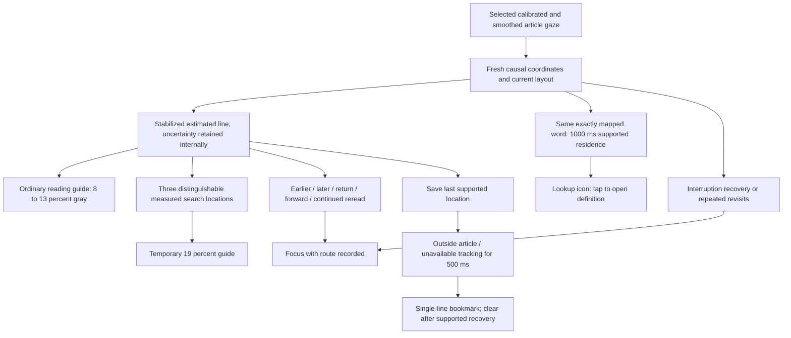

# Reading aid implementation V5

Implemented for the user's 2026-10-19 proposal. Profile: `EVIDENCE_ALIGNED_V5`.
Article, Scanpath pilot and Scanpath replay select this profile. Earlier profiles
remain available to deterministic tests; the frozen scanpath extractor is unchanged.

Owner correction: the visible line guide and blue bookmark must both remain
**single-line**. The earlier automatic three-row display was rejected. Bookmark
activation from within-article row jumps is removed from this profile.

## Flow

## Operational rules

### Location and guide

- Consume the same selected coordinate stream as the dot. During automatic
  scrolling, stabilize body-content Y and project it into the current viewport.
- Use a trailing 150 ms median and require 150 ms of fresh row-candidate residence
  before publishing support. A duplicate capture adds no time. A gap over 250 ms,
  missing coordinates, eye closure or an operational pause breaks pending support.
- No beginning/end fraction of a line is required. Ordinary supported reading
  receives the guide without a difficulty classification.
- The visible line guide highlights **one stabilized estimated row**. It never
  expands automatically into a neighbouring-row band. A single displayed row is
  the owner's chosen presentation, not a claim of validated row accuracy.
- A supplied measured error radius defines internal row uncertainty. **Current
  calibration has no saved error radius**; internal neighbouring-row bounds are
  logged as `neighboring_rows_uncertainty_unknown`, not painted. They are an
  engineering fallback, not a coverage guarantee. Jitter is not accuracy.
- Search emphasis requires three pairwise separated **measured** intervals, such
  as L5 → L7 → L6, within 8 seconds. Unknown-error input cannot activate it.
  Each new witness triple may receive 19% emphasis for 1.5 seconds.
- Gray target opacity ramps from 8% toward 13% over 1.5 seconds of the current
  supported visit. Presentation entry is 150 ms. After the last supported
  delivery: retain for 750 ms, then fade out over 300 ms. These clocks are separate.
- Reader strength caps apply. The separately selected sentence option retains
  its text-context behaviour; the default line option stays one row. Background
  spans preserve glyph color and wrapping.

### Word offer

- Require 1000 ms of fresh, contiguous supported residence on the same exact
  mapped word. Missing intervals, duplicates and unsettled locations add no time.
- The selected point must be inside that word's current screen rectangle, and
  its UTF-16 range must belong to the mapped row. No nearest-word expansion.
- If measured uncertainty is supplied, its entire rectangular bound must fit
  inside the word. Without that measurement, retain the existing exact mapper
  gate and log `mapping_only_unvalidated`; this is **not validated word accuracy**.
- Present the existing lookup icon. It expires after its existing 5-second offer
  lifetime. Only a tap opens the definition. Do not offer again for the same
  unresolved word, including after a brief loss and return. Supported residence
  on a different valid word resolves the earlier visit.

### Focus

- New route: five stabilized visits A → B → A-region → C → D, with B later than
  A and A-region < C < D ≤ B, within 15 seconds. The broad departure/return bands
  must be separate; adjacent forward reread steps use stable row order. Example:
  L4 → L7 → L4 → L5 → L6. This is an **online rereading prefix**, not proof that a
  sentence was misunderstood. Traces state whether movement distinguishability
  was measured or remained unknown.
- Preserve interruption recovery (three separately qualified unavailable/recovery
  episodes within 30 seconds) and font-aware repeated A–B–A–B visits. Missing gaze
  is labelled tracking unavailability. Route IDs remain separate in action logs.
- First broad route activates at 50%; a second nonoverlapping sequence may reach
  100%. Existing routes retain their two-strength schedules and reader caps.
- Both styles enter over 400 ms. Hold for 3 seconds of fresh **supported reading**,
  then fade over 7 seconds of supported reading. Ticks, duplicates, loss and
  unsupported transition time cannot advance recovery. Refreshes preserve recovery
  progress and do not restart a continuous presentation's onset animation.
- Retain the existing styles and maximum 85% surrounding suppression. Protect
  the reread passage plus neighbouring context during tracking and scroll holds.
  If that leaves no space to shade, legibility takes priority over a visible mask.

### Bookmark

- Save a single supported row only when it agrees with the current eligible
  line mapper. A different coarse row without that agreement invalidates an
  unshown saved source, rather than presenting a stale, apparently precise marker.
- Activate after **500 ms of outside-article gaze** (at least three fresh samples),
  or **500 ms of tracking unavailability**. Keep those two reasons distinct.
  Earlier-row and skipped-row movements **do not activate this bookmark**.
  The marker freezes at the saved line rather than following the departure.
- Minimum visibility: 1.5 seconds. Thereafter clear after 1 second of supported
  return to the saved row, or 1.5 seconds of coherent same/next-row reading elsewhere.
- Fresh article input may bridge the settling of a new row, but only supported
  capture intervals earn dismissal time. A brief glance does not clear the cue.
- Mapper-rejected observations break precise return credit. A new accepted run
  starts at its first accepted capture; earlier coarse residence cannot fill in
  rejected time. Bookmark support has its own evidence IDs in the trace.
- Clear invalid article/layout anchors; bound a cue to 30 seconds. Layout reflow
  invalidates source coordinates. Same-layout viewport translation retains the
  supported content location where applicable.

All numerical settings above are engineering/pilot choices. They are not
published optimal thresholds, confidence probabilities or evidence of benefit.
Synthetic tests establish software contracts, not reading difficulty or efficacy.

## What the cited studies actually establish

| Primary source | Findings relevant to the implementation | Limits |
|---|---|---|
| [Wang et al., 2023](https://arxiv.org/html/2303.16346), §§3–5 | Exploratory lab study with 20 low-vision and 20 sighted participants; Tobii Pro Fusion, 120 Hz, reading aloud. Measured lines searched before the next line was located and proposed line/word assistance concepts. | No trial of this aid; desktop aloud-reading findings do not validate silent phone reading, row mapping, gray opacity or timing. |
| [Hiraoka et al., 2016](https://doi.org/10.1145/2993148.2993167), [author paper](https://www.phontron.com/paper/hiraoka16icmi.pdf), §§4–6 | Ten analyzed Japanese graduate students reading English, desktop Tobii X2-30. Per-word gaze and lexical features predicted post-reading known/unknown word reports; reported F-measure 0.556 versus threshold baseline 0.422. | Small L2 sample and a word-knowledge target. No validated 1000 ms cutoff, phone word accuracy or definition-offer benefit. |
| [von der Malsburg & Vasishth, 2011](https://tmalsburg.github.io/MalsburgVasishth2011.pdf), pp.117–123 | Reanalysis of 44 participants' Spanish ambiguous-sentence data distinguished regression patterns. Whole-sentence rereading varied with manipulated syntactic conditions; short regressions were less specific. | Rereading occurred in multiple conditions. Sentence analysis does not validate this five-row online prefix or a focus intervention. |
| [Cane et al., 2012](https://doi.org/10.1080/17470218.2012.656666), [article PDF](https://www.interruptions.net/literature/Cane-QJExpPsychol12.pdf), Experiment 2 | Controlled desktop paragraph reading with EyeLink 1000 and imposed spoken-story interruptions. A highlighted interruption word aided resumption. | Supports a spatial recovery cue in that task. No evidence that missing phone gaze means forgotten location, or that our dismissal times are optimal. |

## Implementation and verification

- `ReadingLocationSupport.kt`: support/uncertainty, fresh word residence and reread prefix.
- `ReadingAidPolicy.kt`: V5 routing, ordinary guide, measured search emphasis and offer.
- `ReadingFocusPolicy.kt` / `ReadingBookmarkPolicy.kt`: independently retained response state.
- `ReadingAidOverlayView.kt` / `ReadingFocusContext.kt`: presentation and protected context.
- `ReadingAidTrace.kt`: route, support provenance, uncertainty and effective guide opacity.
- Replay includes **Broad passage rereading**. Article demo remains a labelled,
  manufactured display preview and does not validate the detectors.

Integrated verification after the single-line correction: **271 tests across 28 aid/replay suites passed**, with
zero failures, errors or skips. App and instrumentation APKs built successfully;
focused whitespace check passed. Private local build/test summary:
`output/aid-single-line-bookmark-check-01/summary.json`. No device install or camera capture
was performed. Physical appearance, actual phone mapping and human reading
benefit require their own checks. `agent-context.md` records the build checkpoint.
