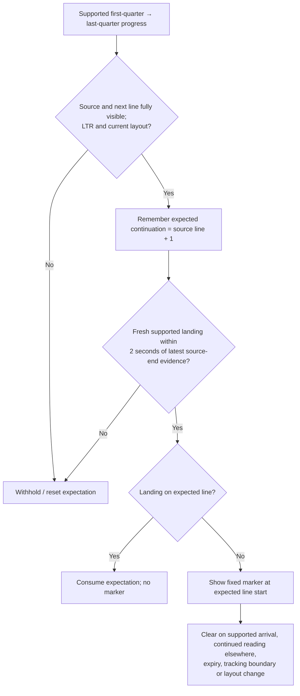

# Expected-continuation line marker

Updated 2026-10-04 · approved by the project owner · experimental implementation.

## What the marker means

The marker offers the next physical text line after an observed beginning-to-end
line visit. It does not classify a jump as an error, establish comprehension, or
claim that rereading is harmful. Current-line highlighting continues to follow
the observed reading location independently.

| Observed sequence | Expected continuation | Marker |
| --- | --- | --- |
| Line 4 beginning → line 4 end → line 5 | Line 5 | None |
| Line 4 beginning → line 4 end → line 1 | Line 5 | At line 5's beginning |
| Line 4 beginning → line 4 end → line 8 | Line 5 | At line 5's beginning |
| Line 4 middle/end only → another line | Not established | None |

These examples use one-based line numbers; Android anchors use zero-based indices.

## Exact implemented rule

1. An established ongoing candidate or supported finalized fixation is observed
   in the first quarter of a fully visible LTR line, then in its last quarter.
   These are observations of text location, not proof that every word was read.
2. The next physical line is remembered only if it is fully visible and nonempty.
3. A fresh established landing on a different line consumes that expectation.
   Landing on the expected line produces no marker. Landing elsewhere chooses
   `A2_CONTINUATION_MISMATCH_V1`, anchored at the expected line.
4. The source-end to landing interval must be at most **2,000 ms**. There is no
   two-second limit on reading the source line. This is a prototype timing setting.
5. A supported expected-line arrival, a distinct later established fixation
   elsewhere, or **1,500 ms** action expiry clears the marker. Repeated updates of
   the same candidate and isolated raw row wobble do not retrigger or clear it.
6. Invalid input, sample/segment boundaries, stale evidence, unsupported/clipped
   geometry, scrolling/reflow, pause and definition consultation reset the state.
   The existing **2,000 ms** non-guide cooldown limits repeated displays.

The display uses `CONTINUATION_LINE_START_CUE_V1`: a fixed **6 dp** blue gutter bar,
alpha **240/255**, ending **4 dp** before text in the existing **16 dp** padding.
Its action strength is always 1; positive strength settings do not attenuate it.
The marker switch, global aids switch, and zero strength still turn it off.
No percentage represents severity or a probability of reading difficulty.

## Source support and limits

[GazePrompt (Wang et al., 2024)](https://arxiv.org/html/2402.12772), §§3.1.1 and
4.3.2, provides gaze-following line highlighting and a margin arrow. In 13 adults
with low vision using a 120 Hz desktop tracker, line support shortened switching
time; switching accuracy did not significantly improve. Its line-jump handling
follows the reader's stabilized destination. It does not validate this new
expected-continuation trigger.

[Slattery & Vasilev (2019)](https://doi.org/10.3758/s13414-019-01742-3) supports
line-start salience through continuously bold first words in desktop reading.
That timing and form differ from this temporary mismatch-triggered gutter cue.
Both are precedents for navigation/salience, not validation of the quarter-line
settings, timeout, fixed visibility, phone detection, or benefit to older readers.

## Versioning, trace and checks

New article/pilot/replay runs use `DEFINITION_PROFILE_V2`, policy version **3**,
and `EXPERIMENTAL_DEFINITION_V2`, `PILOT_DEFINITION_*_V2` or `REPLAY_DEFINITION_V2`.
The legacy magnifier profile becomes `EXPERIMENTAL_PROFILE_V2`. Frozen extractor,
P01–P13 detector labels and comparison/measurement protocols are unchanged.
P09 continues to report qualifying adjacent-line sweeps; it no longer selects a
marker. Do not pool the old post-landing cue with this new condition.

Actions retain separate beginning/end/landing evidence IDs, observed line indices,
and capture/delivery bounds in `continuation_evidence`; the action anchor is the
expected line. No camera images or new raw-coordinate export are introduced.
Replay adds `continuation_return` and `continuation_skip`; `return_sweep` now
expects line guidance without a marker. The article's four-second presentation
demo shows the fixed form without claiming detector evidence.

Software checks and review results are recorded in
`output/continuation-marker-check-01/summary.json`. Both APKs assemble. The first
JVM gate stopped at a test-only field-name error, now corrected; retest approval
is pending. Android fixtures compile but have not run on a phone. Synthetic tests
can establish software behavior; phone appearance and human usefulness remain
untested.
