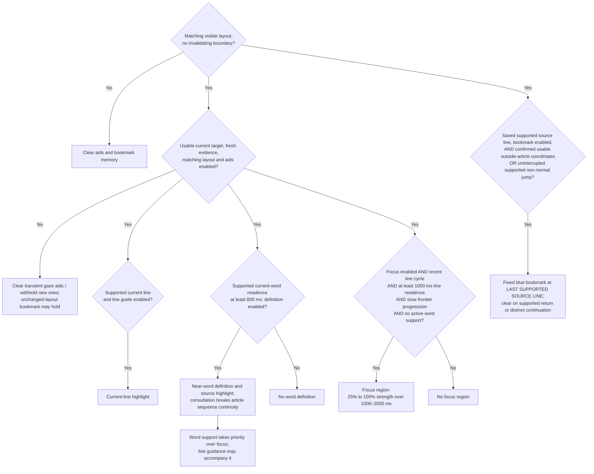

# Scanpath triggers and visual aids: implementation evidence review

**2026-10-13 bookmark amendment:** current article/pilot/replay use definition
V3 / policy 4 and the [last recorded-line bookmark](scanpath-reading-bookmark.md).
EB15/CW12 support cues at known interruption locations, not the autonomous
outside/jump trigger or phone gutter bar. The current trigger dictionary/diagram
below reflect that amendment; the original October 3 audit and historical results
retain their dates. Updated software checks cover 94 JVM cases and 32 distinct
camera-free A56 cases across initial/corrected runs; human benefit remains untested.

**2026-10-08 owner-selected default:** focus is now enabled by default in the
article, pilot and replay preferences for prototype inspection. The historical
default-off/opt-in recommendation below describes the reviewed October 3 build;
the trigger, strength rule and human-validation limits remain unchanged.

**Historical 2026-10-04 navigation amendment:** the [continuation marker](scanpath-continuation-marker.md)
supersedes the old P09 landing cue. Article/pilot/replay use definition profile V2
and policy v3. The magnifier rows and earlier audit results below remain historical;
the current word route is documented in [article definitions](article-definition-aid.md).

**Later 2026-10-03 article amendment:** ordinary articles now use the separate
[definition aid](article-definition-aid.md), with H03/M25 primary precedents,
an exploratory 800 ms residence rule and consultation boundaries. The audit below
describes the earlier magnifier profile and its historical replay/pilot results.

**2026-10-03.** Reviewed the P01–P13 and four-aid prototype at `b2b7a23`,
with the subsequent explicit presentation demo. This is a targeted primary-source
appraisal and source review, not a systematic review or participant result.

## Review judgment

The implementation provides inspectable rules for observable word/line behavior
and four independently controllable aid forms. A panel can examine each trigger,
its source relationship, numeric settings, exclusions and resulting display.

The strongest intervention precedent concerns line guidance. Word support has
a related implemented method precedent, with important differences in the
activation rule. The exact line-cycle-to-focus rule and automatic strength
function lack direct intervention validation in the reviewed sources.

The current defensible claim is that NewsMead implements **experimental,
study-informed assistance rules** and a pilot to examine them. A claim that it
already detects difficulty accurately or that every triggered aid improves
reading is unsupported. Adding references cannot resolve a missing result.

## Trigger-focused flowchart

This diagram describes implemented software decisions, not a published scanpath
figure or diagnostic model. Branches are independent; they are not scaffold levels.

The bookmark's enable/source checks apply to either departure route. Failed
branches do not remove unrelated qualifying aid forms. Transient aids require
current support; the bookmark retains its saved location/static cue through
ordinary tracking loss in unchanged geometry. Layout/lifecycle/consultation
invalidation clears it. This diagram is a software rule, not an attention diagnosis.

## Exact current trigger dictionary

| Aid | Trigger and limits | Display and strength | Evidence status |
| --- | --- | --- | --- |
| A1 current-line highlight | Supported finalized candidate or established ongoing candidate; assigned line matches latest eligible raw target. Line guide enabled. | Yellow line emphasis. Adaptive baseline strength 0.25, or reader-selected fixed value/cap. | Related gaze-following line form; the independent phone cue and exact support rule have not been evaluated. |
| A2 last recorded-line bookmark | Remembered supported fully visible LTR source; sustained usable outside-article coordinates for 100 ms / 3 samples, or a supported non-normal jump within the same segment and 125 ms transition gap. Same-line/normal-next-line progression produces no cue; missing input breaks comparison, not saved memory. | Fixed 6 dp / alpha 240 blue marker at the **source** line's beginning, with a 4 dp gutter gap. Holds until supported return, distinct continuation or explicit invalidation. Off/zero disables; positive strength does not attenuate. | EB15/CW12 support known-interruption resumption cues. Exact autonomous trigger, gutter form, timing and phone benefit remain experimental; deliberate rereading/skipping must remain possible. |
| A3 current word definition | Current matching word/line and at least 800 ms observed current-word time from supported finalized visit time plus a nonoverlapping established prefix, or the prefix alone. Definition enabled; no mandatory refixation count. | Near-word definition card with persistent source highlight. Consultation excludes its interval and resets article sequence continuity. | H03/M25 support lexical assistance; [current source review](article-definition-aid.md) records population, hardware and transfer limits. The exact automatic cutoff and phone benefit are unvalidated. |
| A4 context focus region | Focus enabled (default on since owner request on October 8). Recent line-level A–B–A–B cycle within the configured two-second window; current-line observed residence ≥1000 ms; slow-frontier flag; current matching target; no active word support. | Current line plus two physical lines on either side remain unveiled. Strength interpolates 0.25→1 over 1000→2000 ms; outside-text veil alpha = 40 × strength out of 255. Span never narrows as strength increases. | Original experimental mapping. Reviewed ruler studies do not validate this exact trigger or this focus treatment. |

Slow-frontier flag: at least a 1000 ms analysis window, observed candidate spans
covering at least 50% of window elapsed time, and frontier gain ≤0.5 physical
lines/s. A frontier is the furthest observed location, not words understood.
The cycle is recent line-history evidence; residence and the displayed anchor
refer to the current line. The policy does not infer the semantic reason for
returning between lines.

Transient aid timing safeguards require coherent capture/delivery times and
evidence no older than 250 ms. Their action lifetime is 1500 ms; non-guide
clearing/expiry introduces a 2000 ms cooldown. The current bookmark instead holds
saved memory/static display through ordinary missing input in unchanged geometry,
with separate fresh departure evidence and explicit resumption/invalidation rules.
These are implementation settings, not study confidence measures or validated
response-time standards.

Code: [policy](../app/src/main/java/com/newsmead/gaze/aid/ReadingAidPolicy.kt),
[profile](../app/src/main/java/com/newsmead/gaze/aid/ReadingAidModels.kt),
[runtime configuration](../app/src/main/java/com/newsmead/gaze/aid/ArticleReadingAidRuntime.kt),
[rendering](../app/src/main/java/com/newsmead/gaze/aid/ReadingAidOverlayView.kt).

## Primary findings and what they support

| Source | Studied population, task and hardware | Finding relevant to this implementation | Limit / exact source location |
| --- | --- | --- | --- |
| [GazePrompt, Wang et al. (2024)](https://arxiv.org/html/2402.12772) | 13 low-vision adults, ages 30–87, reading aloud on desktop; 120 Hz Tobii Pro Fusion. | Line-support switching time improved (p=.014); switching accuracy did not. Word support used within-pass duration/refixation triggers; its tested word-time/error effects were nonsignificant (p=.86/.24), with speech and magnifier choices. | Method/form precedent, not a NewsMead validation. §§3.1, 3.2.3, 4.1, 4.3.2–4.3.3; Figures 2 and A.1. |
| [Slattery & Vasilev (2019)](https://pmc.ncbi.nlm.nih.gov/articles/PMC6647890/) | 32 adults, normal/corrected vision, silent desktop stories; EyeLink 1000, 1000 Hz and head support. | Continuously bold line-initial words moved landings toward the margin and reduced undersweeps. Global reading time did not improve. | Supports persistent start salience, not our post-landing marker timing or strength. Methods, Tables 2–5; journal pp.1198–1202. |
| [Digital Reading Rulers, Niklaus et al. (2023)](https://thereadabilityconsortium.org/wp-content/uploads/2023/08/Digital-Reading-Rulers-Evaluating-Inclusively-Designed-Rulers-for-Readers-With-Dyslexia-and-Without.pdf) | 177 adult crowdworkers; 91 in the self-report/screening dyslexia group. Mouse-controlled desktop rulers; no gaze detector. | Grey Bar improved speed versus no ruler in that group. Other highlighted pairwise results do not establish Shade/Underline superiority over no ruler. Comprehension gains were nonsignificant. | Form comparison, not evidence for cycle-triggered focus or help in older phone readers. §§4.1–4.4, Table 4 (PDF p.11), §5.5. |
| [Schotter, Tran & Rayner (2014)](https://doi.org/10.1177/0956797614531148) ([primary full issue](https://journals.sagepub.com/cms/asset/8fb4a866-be79-4397-b847-74a1d85670f1/psys_25_6_full-issue_pdf.pdf#page=66)) | 40 English-speaking undergraduates; single-line sentences, EyeLink 1000 at 1000 Hz. | Masking previously passed words reduced comprehension. | Supports allowing rereading, not diagnosing returns as difficulty or proving focus benefit. Article pp.1218–1226; Results p.1221, Figure 2. |
| [Olivier, Guérin-Dugué & Durand (2022)](https://doi.org/10.16910/jemr.15.4.5) ([primary PDF](https://bop.unibe.ch/JEMR/article/download/8415/11898/39368)) | Fifteen retained adults, topic-relevance reading, EyeLink at 1000 Hz. | Signed word-distance codes describe next/farther-forward, same-word and backward movements; HSMM interprets phases over sequences. | Supports movement encoding. It does not supply independent difficulty labels for our A–B–A–B detector or line bins. Alphabet/method pp.4–6; fitted phases pp.8–11. Current PDF text lookup failed; these locations and extraction are retained from the existing verified ground-truth audit. |

Existing supporting records:
[pattern ground-truth audit](scanpath-pattern-ground-truth-audit.md),
[aid evidence contract](scanpath-adaptive-aid-design.md),
[source ledger](scanpath-scaffolding-evidence.md).

### Historical magnifier trigger: a material adaptation

GazePrompt's default activation was **first fixation >500 ms OR refixations >4
OR within-pass total >1500 ms**, with duration customization. The retained
NewsMead magnifier comparison uses
**refixations ≥2 AND observed residence ≥750 ms**. The operators, counts,
durations and input measurements differ. Cite the original as a precedent;
do not call that rule a replication or its numbers published cutoffs. The current
definition route instead uses 800 ms observed residence; its separate evidence
and limits are recorded in [article definitions](article-definition-aid.md).

## Claims to challenge before panel presentation

| Panel question / proposed claim | Review and required response |
| --- | --- |
| “Does this pattern conclusively mean the reader is struggling?” | No calibrated mapping exists here. Describe the observed navigation/residence and the experimental support opportunity. Do not claim dyslexia, ADHD, cognitive overload, misunderstanding or zero comprehension. |
| “Where did the word cutoff come from?” | The current definition cutoff is 800 ms observed residence, an explicit prototype parameter. The historical magnifier uses two refixations and 750 ms. No matching automatic-trigger validation is claimed for either condition. |
| “Why does a cycle cause a focus window?” | The compound trigger is a hypothesis. It lacks a directly tested pattern-to-focus intervention. Keep opt-in/default-off status, test need and distraction independently, and consider a line bar or reader-requested cue as a separate comparator. |
| “Why does stronger mean more helpful?” | This monotonic dose rule is unvalidated. Compare parameter values within the same aid/context against fixed strength and no aid; include comprehension, burden and wrong/unwanted cues. |
| “Does the marker improve line landing accuracy?” | It offers an expected continuation after a different supported landing; it does not claim the jump was wrong. The selective rule and phone benefit require independent evaluation. Published persistent/start-following cues use different timing. |
| “Why not intervene on every return?” | Returns can be useful rereading. The implementation retains text access and does not automatically escalate on P03/P08/P10 alone. |
| “Does the demo demonstrate accurate detection?” | No. It is an explicit presentation cycle. Synthetic replay exercises rules; human measurement requires the separate pilot and independent outcomes. |

No reviewed source supplies transferable difficulty probabilities or decision
weights for these rules. P-values, assignment agreement and HSMM state
probabilities cannot be substituted for such probabilities.

## Concrete findings and repairs

1. Two task-to-pattern IDs in the pilot guide were corrected to match source:
   backward words → P03/P07; forward nonadjacent jump → P02, return → P03.
2. Review found that replay/pilot's 68 dp magnifier strips had only 36 dp usable height,
   insufficient for full 1.5× 22 dp Arial font metrics. Vertical padding is now
   10 dp in both screens, providing 48 dp; viewport reservation remains 68 dp. Both demo word
   strengths are asserted nonempty in the compiled activity test.
3. The explicit demo uses existing rendering views with `DEMO_PRESENTATION_ONLY`
   identity, empty evidence/source IDs and no detector/runtime/logger. Required
   renderer time fields are presentation elapsed time, never measurement output.
4. Exact trigger/profile/dose values remain visible and marked experimental.
   This review does not silently change the live policy or manufacture a study
   validation of it. Further decisions require the relevant pilot evidence.

## Demo use and current checks

Home **Scanpath replay** → **Demo cycle**. It advances every four seconds through
baseline, current-line highlight, line-start marker, word magnifier at 25%/100%,
and focus at 25%/100%, then repeats. Previous/Next step manually; Stop clears it.
Pause, scenario/control changes and changed geometry also terminate it. It
starts no camera/provider/calibration and publishes no replay result or trace.
The line demonstration uses 60% for visibility; live adaptive line baseline
remains 25%. Presentation stages do not assert that the live trigger occurred.

The corrected build passes 56 focused JVM tests and assembles app/test APKs.
Independent source review closed the bounded timing/padding corrections.
The authorized corrected A56/API 36 run passes all 15 camera-free device checks,
including four demo tests for rendering/timer/pause/scroll and a centered-strip
fit regression. Synthetic app-only word/focus previews were inspected.

The subsequently authorized A56/API 36 attempt passed all five synthetic pilot
activity checks, but failed all four demo readiness checks and four replay checks
on fractional early callback handling. [Device check 04](scanpath-device-check-04.md)
records the six passes/eight failures and installed hashes. Local timing/fit
fixes passed independent review, 56 focused JVM tests and both APK assemblies.
The separately authorized corrected retest passes all 15 checks in 50.908 s,
with all five synthetic replay scenarios completed and drawn aid proxies.
No human validity follows from these software results.
No human measurements or intervention outcomes were collected.

## Appraisal method and attribution

Applied the installed scientific-critical-thinking skill to primary methods,
outcomes, comparators, populations and transfer limits. Procedural reference:
Kassis et al. (2026), [Scientific Agent Skills](https://arxiv.org/abs/2609.00065),
record checked 2026-10-03. This is authoring-method provenance, not reading-aid
evidence. The flowchart represents NewsMead source decisions; it is not a redraw
of a study's original eye-movement figure.
