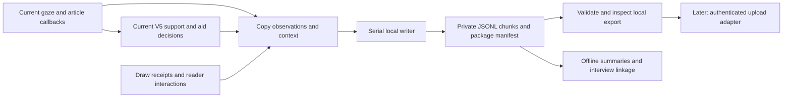

# StabiliRead feasibility data framework

Draft 0.1 — 2026-10-22. **Design and synthetic examples only; no live collector or
Firebase integration is implemented by this package.** This is a proposed data
contract around the current scanpath/V5 system, not a replacement study protocol.

## 1. What this phase should answer

Can volunteers use their own phones to produce interpretable reading records?
Can we explain which evidence the system had, which aid it selected, what the app
drew, and how the reader responded? Where do tracking, mapping, recording or
usability failures occur?

Self-selected articles and home use are the proposed setting. A week of use,
participant numbers, article requirements and study conditions remain protocol
decisions. This framework does not require controlled articles or a personalized
reading baseline. Calibration metadata is still needed to interpret coordinates.

This phase can describe technical feasibility, data availability, system behavior
and user experience. It cannot establish gaze accuracy, the accuracy of a
reading-difficulty classifier, or a causal reading benefit by itself. Interviews
and any independent reading outcomes complement the records; gaze-derived labels
must not become their own ground truth.

## 2. Proposed collection flow

The collector observes the existing system. It must not introduce another gaze
filter, change thresholds, change the selected stream, or turn disabled aid
components into hidden evaluations. Log `not_evaluated` when a component is gated.
Passive evaluation in an aids-off comparison would be a separate explicit change.

## 3. Units, identity and session boundaries

| Identifier | Meaning and rule |
| --- | --- |
| `study_id`, `participant_id` | Study code and pseudonymous enrollment code. Keep the name/contact lookup separately. These codes do not make the dataset anonymous. |
| `installation_id` | Random study-installation ID, not a hardware serial or advertising ID. A phone replacement gets a new installation ID. |
| `session_id` | One article visit during a continuous foreground reading period. New article, backgrounding or process restart ends the visit; returning creates a new visit with `previous_session_id` where known. No duration-based claim that the article was finished. |
| `article_snapshot_id` | Immutable copy of the exact rendered body, with its hash and source metadata. URL alone is insufficient because online content can change. Multiple visits can reference the same snapshot. |
| `layout_id` | A collection ID for a text/typography/layout epoch. Also retain the native geometry snapshot ID. Reflow creates a new layout. |
| `viewport_id` | One timestamped origin/visible-rectangle state within a layout. Scrolling can change it while the native geometry ID stays the same. |
| `provider_epoch_id` | New ID whenever the provider starts or its delivery sequence resets. Delivery IDs are unique only within that epoch. |
| `generation`, `segment` | Preserve native engine/support scope. Native candidate/visit/event IDs must also carry their producer and generation; they are not globally unique. |
| `record_id`, `seq` | Globally unique record ID and strictly increasing, session-local append sequence. References use record IDs, including a specific evidence revision. |
| `presentation_id` | Proposed stable ID for one continuous presentation on an aid channel, spanning action refreshes. This does not exist as a study-level ID yet. |

Enrollment and attempted starts need a small separate operations register, including
unsupported phones and failures before a reading session can start. Successful
session files alone cannot supply the denominator for recruitment/device success.
Firebase account identifiers, if later needed for access control, should be mapped
to study codes separately from analytical records. Current `BYPASS_LOGIN=true`
is a deployment decision to revisit before authenticated remote collection.

## 4. Shared record envelope

Every JSONL line has `schema_version`, `kind`, `record_id`, `seq`, study /
participant / installation / session identifiers, `recorded_elapsed_ms`, and a
typed `payload`. The [draft schema](study-data/record-schema-v0.1.json) and
[synthetic example](study-data/example-session.jsonl) make this concrete.
The [manifest schema](study-data/manifest-schema-v0.1.json) and
[example manifest](study-data/example-manifest.json) describe package integrity,
known losses and recovery separately from the event stream.

- `recorded_elapsed_ms`: Android monotonic elapsed time when the serial collector
  appends the record. Preserve source event times separately; append order does
  not imply capture order. A reboot starts a new clock domain and session.
- Capture, delivery, support confirmation, decision and draw clocks are distinct
  monotonic timestamps in **milliseconds**. Convert provider nanoseconds once.
  Session start carries one UTC/elapsed anchor for approximate calendar grouping;
  never use wall-clock differences for gaze residence or processing latency.
- Selected and calibrated pre-smoothing coordinates are **physical screen pixels**.
  Body-content coordinates are explicitly separate. Do not silently substitute
  one frame for another. The source's `raw` means calibrated pre-smoothing gaze,
  not camera images or uncalibrated model output.
- Lines are zero-based physical layout rows; text ranges are half-open Android
  **UTF-16** offsets. Store language, text direction and layout. A displayed word
  match is not independently validated exact-word accuracy.
- Unknown values are explicit `null` with a reason/status. Zero means a measured
  zero. JSON must contain no NaN or Infinity. Do not turn missing gaze into `(0,0)`.
- Native detail objects retain producer, algorithm version and native fields;
  normalized fields are an index, not permission to discard the native evidence.

## 5. Records to save

`Required` below means required in the proposed local collection profile, not
already implemented. The schema validates record shapes; the semantic rules and
readiness checks below also have to pass.

| Record kind | Required content | When / why |
| --- | --- | --- |
| `session_start` | Previous visit; UTC/elapsed anchor and clock domain; build/model/calibration fingerprints; device model/OS/display/density/font scale; collection profile; current component versions and implementation status; configuration reference. | First record of every visit. Record unavailable calibration error as unknown, not zero. Snapshot actual settings instead of copying historical manuscript defaults. |
| `configuration` | Full initial values and subsequent changes: coordinate selection, motion compensation, extractor/support/policy/renderer versions, numerical settings, aid toggles/caps/style, reader typography/theme, diagnostic dot/demo state and logging options. | Before first evaluated input and at every change. Distinguish natural use, diagnostic-dot, demo and validation conditions. A hash must resolve to the actual saved settings. |
| `text_snapshot` | Snapshot ID, exact rendered body, SHA-256 of its UTF-8 encoding, source article ID/domain/URL where applicable, language, selection route such as recommendation/search, and fetch time if known. | Once per distinct body; retain privately or reference a verified packaged asset. A hash without recoverable text is insufficient. Article selection route may be unknown; do not infer preference from an open. |
| `layout_snapshot` | Collection layout ID, native snapshot ID, body reference, generation, typography/direction and body dimensions; physical line bounds and UTF-16 ranges; exact word ranges/bounds when needed for word reanalysis. | At creation/reflow. A new body or layout must not reuse old row evidence. Save geometry rather than expecting another phone to reproduce wrapping. |
| `viewport` | Unique viewport ID, layout reference, effective monotonic time, text screen origin, visible rectangle, scroll position, manual/auto/unknown source and available motion metadata. | Initial state and every relevant geometry/scroll update. Preserve the capture-time state selected by the current pipeline. Do not use a future origin for an earlier capture. |
| `gaze_observation` | Provider epoch/delivery ID; capture/delivery times; provider reason and counters; pre-smoothing and selected screen points; frame/stream; mapped row/word; eligibility/exclusion; layout and capture/presentation viewport references; native motion-compensation values when present. | Every delivered callback, including invalid, stale and stopped observations, during the visit. Store each delivery, but mark whether it supplies a fresh capture. This is not a recording of every camera frame. |
| `support_revision` | Producer, native entity ID, generation/segment, revision and phase; layout; capture onset/end and first-confirmation clocks; row/word/band; uncertainty provenance; exact native evidence. | Every relevant revision/invalidation of V5 location, word, reread, alternation, departure/return and qualification evidence, including pending evidence. Preserve exact input/support revisions for decisions. |
| `aid_evaluation` | Trigger/input reference and one entry for each of guide, lookup, bookmark and focus: `pending`, `qualified`, `evaluated_no_match` or `not_evaluated`; reason, config reference and support references. | At each evaluation opportunity, including gate changes/ticks that affect eligibility. Initially retain these explicitly. Any later batching requires a versioned, lossless account of status changes and denominators. |
| `aid_decision` | Native status/rule/reason; aid channel, action ID if any; decision time; evaluation and evidence revision references; native action including target, strength and version. | Every chosen/updated/withheld/cleared decision. A new action ID can be a refresh of an existing display. |
| `aid_presentation` | Presentation ID/channel; action reference; requested/applied/draw-proxy/withheld/cleared state, receipt time/reason, foreground state, actual target/opacity where available; censoring. | State transitions and meaningful changes; retain first/last draw evidence and any coalescing counts. `drawn_proxy` is not verified human exposure; `verified_visibility` stays false. |
| `interaction` | Lookup offer accepted/dismissed/timed out, panel opened/closed, aid controls, explicit stop, feedback or navigation; action/presentation references when applicable; native detail. | On interaction. An offer is not an opened definition; opening is not evidence it helped. Record user feedback separately from computed labels. |
| `boundary` | Reason, source event time, affected scope and whether continuity ended. Includes unavailable/blink/stale input, manual scroll, reflow, controls/consultation pause, provider restart, lifecycle and resource rotation. | On every relevant boundary; preserve the current pipeline's own continuity decisions. Do not invent gaze samples through pauses. Tracking loss is unavailability, not inattention. |
| `collector_health` | Delivered/retained/dropped counts, queue depth, persisted-through sequence, bytes, failure state and applicable counter epoch. | Periodically and at stop/recovery. Collection health is separate from gaze quality. |
| `collector_loss` | Loss ID/counter epoch, affected kinds, exact/estimated/unknown count, reason, source time and provider/delivery ranges where known, missing record IDs where assigned and recovery boundary reference where available. | At detection/recovery while the original clock is valid. Health/end/manifest records reference these losses. Missing ranges stay unknown; do not manufacture exact loss times. |
| `session_end` | Known end reason/time; record and observation counts; drops and loss-record references; explicit closure status. | Normal close in the original clock domain. A recovered partial stream can have no end record; recovery belongs in the manifest. Finalization is separately verified after flush/close. Never synthesize a normal user exit after a crash. |
| `scanpath_output` | Optional native candidate/fixation/P01–P13 output, producer/version, generation/segment, entity/revision, capture/evidence clocks, phase and limitations. | Existing outputs can be retained as exploratory evidence. P10 phases, P11 overlapping sequences and P12 cumulative updates must not be summed as independent events. Full catalogue revision can wait. |

The example includes synthetic geometry, observations, support, nonactivation,
action refresh, draw proxies, a missing observation and a censored support end.
One explicitly localized optional-output loss makes `content_complete=false`
even though the example package closes normally and its file hash is verifiable.
It is a short **sparse illustration**, not a plausible human trace or detector
replay fixture. Native detail fields illustrate adapters that still need building.

### V5 evidence that must survive normalization

| Component | Preserve | Interpretation limit |
| --- | --- | --- |
| Guide | Supported visit revisions, estimated row and uncertainty band/provenance, fresh residence, direction/settling witnesses, selected style and actual target range. | Ordinary support does not diagnose difficulty. Visible three-line width is a presentation choice, not a measured error interval. |
| Lookup | Exact mapped word offsets/bounds, supported residence, eligibility and `mapping_only_unvalidated` provenance; offer and consultation lifecycle. | V5 word residence is different from P12 accumulation. Current mapping alone does not establish exact-word accuracy. |
| Bookmark | Saved supported source, mapper agreement, outside-article versus unavailable departure, clocks/counts, withheld anchors, display and supported return/clear. | Missingness and deliberate departure remain distinguishable; absence of tracking does not identify its cause. |
| Focus | Pending/completed broad reread, separated alternation and loss/return witnesses; route, independent episode IDs, qualification/credit ledger, target, strength, recovery accumulator and invalidations. | Preserve completed episodes even when reader settings withhold presentation. Controller recovery/fade time is not an independent human recovery outcome. Gated routes may never have been evaluated. |

Do not discard observed support because it failed to trigger an aid. Record
support expiry and rejection reasons, so an unfinished episode is distinguishable
from a completed episode with no presentation. Preserve state before reset.

## 6. Minimal useful analysis, derived offline

Keep raw facts stable; regenerate summaries with a separate analysis version.
Report by participant and phone, with session/article context. Repeated sessions
from one participant do not become independent participants.

| Summary | Numerator / denominator or definition |
| --- | --- |
| Start and completion feasibility | Starts and finalized/recovered/incomplete visits, plus pre-session failures from the operations register. Distinguish visit closure from finishing an article. |
| Foreground reading opportunity | Foreground intervals with article ready; separately report intervals where tracking was expected, intentionally off, or paused by controls/consultation. Not a measure of attention. |
| Fresh eligible callback fraction | Unique fresh eligible capture deliveries / all provider deliveries in the declared tracking-expected intervals. Separately tabulate stale/duplicate/invalid reasons. Callback mix is not accuracy. |
| Eligible time coverage | Union of intervals between consecutive fresh eligible captures in the same eligible continuity segment, with gap at most the configured cap; divide by tracking-expected time. Do not extend the last sample or bridge a gap. This is an observation-coverage proxy. |
| Delivery latency and cadence | Delivery minus capture where both clocks share the declared domain; fresh-capture interarrival distributions. Report invalid/out-of-order timestamps and distributions, not only an average FPS. |
| Evidence and aid behavior | Supported visits/qualified independent episodes by route; evaluation status and reason counts; decisions versus continuous presentation episodes; withholding and settings. Keep duration/coverage denominators beside any per-minute rates. |
| Lookup and reader response | Accepted offers / actionable offers with an observed lifecycle; dismissed/time-out/censored separately. Aid adjustments, voluntary disabling and linked feedback. These are use/acceptability signals. |
| Render evidence | First/last positive draw proxies and clear/withheld states. Any display-duration estimate states its boundary assumptions and censoring; no claim of verified exposure. |
| Recording reliability | Provider deliveries, enqueued/serialized/persisted observations, explicitly dropped records, file validation and finalized package counts. Zero logger drops does not mean zero provider/camera drops. |

### Proposed retrieval and exploration workflow

1. After a supervised session, export the finalized app-private package to the
   approved researcher storage location. Keep the original package unchanged;
   record who exported it and when, then verify its manifest, chunk hashes,
   record counts and closure/recovery state before analysis.
2. Run a production package validator before creating analysis tables. It should
   identify malformed records, duplicate IDs, unresolved references, missing
   chunks, declared losses and partial/recovered sessions without silently
   dropping them. The current
   [example checker](../tools/gaze/check_study_data_example.py) checks only the
   synthetic example; the real-package validator remains to be implemented.
3. Convert validated events into versioned analysis tables while preserving the
   raw package: sessions/devices, gaze observations, support/evaluation/aid
   events, reader interactions, boundaries/losses and feedback. Keep timestamps,
   units, coordinate frames and missingness reasons explicit. Save derived
   tables (for example CSV for small summaries and Parquet for large observation
   tables) with the analysis-code and schema versions that produced them.
4. Explore and plot from a local Python environment using
   [JupyterLab](https://jupyter.org/install) and tools such as
   [pandas](https://pandas.pydata.org/docs/getting_started/). Anaconda is
   optional; [Anaconda Distribution](https://www.anaconda.com/about-us) is an
   installer/environment bundle that includes Python and Jupyter, not a
   separate analysis method. SQL is optional too: local
   [DuckDB](https://duckdb.org/docs/stable/clients/python/overview) can query
   CSV, JSON and Parquet files when table joins or grouped queries are more
   convenient than Python code.
5. Keep raw participant packages and notebook outputs in institution-approved,
   access-controlled storage. [Google Colab](https://research.google.com/colaboratory/faq.html)
   notebooks are stored in Google Drive and execute in a hosted virtual
   machine, so use Colab for synthetic/demo data unless the institution
   explicitly approves cloud processing of the study records.

This is a proposed workflow, not an implemented export/analysis application.
The collection package and analysis tables should remain backend-neutral so the
same verified package can later feed a cloud upload adapter.

Descriptive P labels can be explored alongside these records, with algorithm
version, overlapping/cumulative semantics and missingness retained. They do not
need a complete redesign for this phase. A separate Mahalanobis adapter can later
use the same session/configuration/action conventions, while retaining its own
features, units and two current trigger definitions. Its prototype is incomplete;
no feature equivalence or completed integration is assumed here.

For interviews or short post-session feedback, link `participant_id` and any
relevant `session_id`/presentation IDs. Store the instrument version, question,
response and coding version separately. Do not infer a participant's opinion
from their gaze or require an interview after every article without a protocol
decision.

## 7. Local storage and later upload boundary

Proposed components: `StudySessionCoordinator`, immutable record adapters,
`LocalStudyWriter`, package integrity checker, and a later `StudyUploadAdapter`.
These are responsibilities to implement, not existing classes or a framework
dependency change. Reuse the existing trace serialization and deterministic
fixtures where their contracts match.

1. An explicit study enrollment/consent state enables collection. Normal login
   alone does not imply research participation. Opening an article then starts
   a visit automatically. For the initial supervised phase, the researcher
   exports finalized packages after the session. Any later home phase requires
   a tested participant-friendly retrieval or synchronization path before it
   begins.
2. Copy small immutable facts at callbacks; serialize/write on a bounded worker
   queue. No file/network IO, text hashing or whole-layout copying per gaze
   callback on the UI or inference thread. Layout/text artifacts are saved once
   per revision. Measure callback overhead on representative phones.
3. Write app-private, backup-excluded `*.partial.jsonl` chunks with ordered
   records. Chunk by measured byte/time budgets; do not reuse the diagnostic
   journal's 2,048-entry ring as the study store. Keep critical state/end records
   available when the numeric stream reaches a limit. Record drop ranges/counts,
   reason and recovery; never silently overwrite earlier study data.
4. Maintain a durable manifest with expected chunk IDs, sequence ranges, byte
   counts, SHA-256 values, schema/build/config versions, coverage losses and
   closure state. Flush/close, verify referenced artifacts, then atomically
   publish a finalized package. A footer's own `complete` flag is insufficient.
   The draft manifest schema separates finalized file integrity from
   `content_complete`; a closed package can contain declared losses. Store
   typed loss markers, and include unknown tail loss in recovery metadata if no
   marker could be written. Coverage-sensitive analyses exclude or censor the
   affected intervals rather than treating a small drop count as harmless.
5. On restart, inspect partial packages, retain the valid prefix and label any
   unknown tail/censored ending. Keep a recovery receipt in the manifest with
   original and recovery clock-domain IDs, recovery UTC/elapsed time, last known
   original timestamp/sequence and nullable actual end. Do not append a footer
   with a new boot's time to the old stream. Keep verified original chunk hashes
   when possible and describe any recovered valid prefix separately. Never join
   across a reboot/provider reset with the old clock/ID scope. Do not report
   records as durable before the declared flush checkpoint. Storage-full and
   write-failure states must be observable.
6. For the initial researcher-export route, retain local data until the
   researcher-side copy is verified against the package manifest and hashes,
   and the retention policy permits deletion. If remote sync is added later,
   use a durable outbox, retry idempotently by package/chunk ID, and store
   transport attempts/acks separately from the analytical event stream.

### Firebase mapping checkpoint — 2026-10-27

The user reports access to the existing Firebase project on the **Spark plan**.
The app has Firebase Authentication and Firestore dependencies, but study login
is currently bypassed and no study-data collector/upload adapter is implemented.
This section updates the earlier open service-choice note; it does not describe
a live integration.

Cloud Firestore is available within Spark's no-cost quotas; the published free
quota includes 1 GiB storage, 50,000 reads/day, 20,000 writes/day and 10 GiB
outbound/month, with one free database per project. The quota is shared with
other apps using the Firebase project. Spark disables a product when its
applicable no-cost quota is exceeded until the next billing cycle. See the
[pricing-plan](https://firebase.google.com/docs/projects/billing/firebase-pricing-plans)
and [Firestore quota](https://firebase.google.com/docs/firestore/pricing)
documentation. Cloud Firestore's hard document-size limit is 1 MiB; see its
[usage limits](https://firebase.google.com/docs/firestore/quotas).

Cloud Storage for Firebase is unavailable on Spark and currently requires the
Blaze billing plan, even if the intended usage would otherwise be no-cost. Do
not assume a Storage bucket can be provisioned or accessed. See [Firebase's
Storage billing requirements](https://firebase.google.com/docs/storage/faqs-storage-changes-announced-sept-2024).

The preferred initial route is **local files plus researcher-controlled
export** to approved research storage. Keep complete recoverable packages
on-device until the exported copy is verified against the manifest and hashes.
This avoids requiring Firebase file storage for the initial supervised study.

Keep the record schema and package format independent of Firebase. A later sync
adapter can upload finalized packages without changing event meaning, timestamps
or IDs; package/chunk IDs, hashes and transport receipts should remain stable and
separate. If future remote storage uses Firestore on Spark, a bounded pilot must
verify that compressed chunks fit below 1 MiB/document and within actual project
quotas, security rules and retry behavior. Never write one document per gaze
sample. The local record identity and meaning survive either route unchanged.

Article text, reading histories and gaze coordinates remain research data.
Finalize the exact text/URL collection and access/retention policy with the study
materials. This design does not collect camera frames, recordings of the face,
names, contacts, hardware IDs or full model feature vectors. No such capture is
required to implement the proposed collector.

## 8. Current source → implementation map

Source checked on 2026-10-22 in the current working tree; this does not identify
the APK installed on any phone. Existing unrelated edits were preserved.

| Source | Available now | Collection work still needed |
| --- | --- | --- |
| [MgazeNetGazeProvider.kt](../app/src/main/java/com/newsmead/gaze/mgazenet/MgazeNetGazeProvider.kt#L53) | Observation clocks, delivery ID/reason, selected/raw points, arrival/busy-drop counters and optional eyelid fields. | Persist observations with epoch and missingness; carry counters without implying they count every physical frame. |
| [ArticleScanpathSession.kt](../app/src/main/java/com/newsmead/gaze/scanpath/ArticleScanpathSession.kt#L167), [ScanpathModels.kt](../app/src/main/java/com/newsmead/gaze/scanpath/ScanpathModels.kt#L25) | Selected sample/mapping, geometry and motion-compensation metadata; generation/candidate/fixation/event callbacks. | Durable sink; immutable layout + viewport history; scoped IDs and boundaries, including invalid inputs. |
| [ArticleFragment.kt](../app/src/main/java/com/newsmead/fragments/article/ArticleFragment.kt#L1330) | Current live pipeline integration; ordinary article opening/scrolling. | Session lifecycle, article/config references, visit linking and automatic recording status. |
| [ReadingLocationSupport.kt](../app/src/main/java/com/newsmead/gaze/aid/ReadingLocationSupport.kt), [ReadingFocusPolicy.kt](../app/src/main/java/com/newsmead/gaze/aid/ReadingFocusPolicy.kt), [ReadingAidPolicy.kt](../app/src/main/java/com/newsmead/gaze/aid/ReadingAidPolicy.kt#L560) | V5 supported locations/words/episodes and aid gates. | Emit pending/revised/rejected/expired evidence and explicit evaluation states before resets, with no detector redesign. |
| [ArticleReadingAidRuntime.kt](../app/src/main/java/com/newsmead/gaze/aid/ArticleReadingAidRuntime.kt#L132), [ReadingAidTrace.kt](../app/src/main/java/com/newsmead/gaze/aid/ReadingAidTrace.kt#L10) | Configuration, decisions, interactions and draw proxies in a bounded in-memory journal, manual private export. | Persistent event sink, stable presentation IDs and explicit closure/censoring. `complete_trace` describes the journal's contract, not this study dataset. |
| [ScanpathTraceWriter.kt](../app/src/main/java/com/newsmead/gaze/scanpath/audit/ScanpathTraceWriter.kt) | Partial/final local writer and typed pilot/replay serialization. | Adapt explicitly: current sample serialization omits motion-compensation fields; cap/finalization alone do not satisfy sustained home collection. Preserve frozen pilot schemas. |
| [StudyConfig.kt](../app/src/main/java/com/newsmead/data/StudyConfig.kt) | Prototype switches, including login bypass and diagnostic visuals. | Snapshot the settings actually active in the selected runtime; choose deployment values before participant use. Legacy baseline/controller constants are not current study measures. |

## 9. Implementation sequence and readiness gates

| Step | Deliverable | Acceptance before progressing |
| --- | --- | --- |
| A — this package | Draft record contract, synthetic examples, source map and unresolved choices. | Review shapes and semantic rules; no claim of a working collector. |
| B — local collector | Session lifecycle, artifact snapshots, observation sink, health/manifest/recovery and private export. | Deterministic fixtures preserve IDs/times/geometry; invalid/stale/duplicate input remains distinguishable; no change to existing outputs. |
| C — V5 instrumentation | All required support/evaluation/decision/presentation/interaction records. | Qualified, pending, no-match, gated, expired and withheld cases are explainable; continuous action refreshes do not inflate presentation counts. |
| D — local rehearsal | End-to-end package inspection and summaries on synthetic/replay input, then separately authorized phone checks. | Reflow/scroll/provider restart/background/crash/storage-full/queue-overflow checks; all references/hashes/counts reconcile; offline use works. Benchmark bytes, callback cost and session endurance; set explicit budgets. |
| E — remote delivery | Authenticated upload adapter and retry/receipt workflow. | Offline retry, duplicate upload, partial upload, cross-participant access denial and acknowledged-chunk reconciliation pass. |
| F — feasibility collection | Approved study configuration and onboarding/support procedure. | Representative phone readiness, collection/retention materials, collection status and stop controls, enrollment register, protocol choices fixed. Software checks alone do not establish human validity. |

Before participant use, resolve: own-phone requirements/calibration procedure;
session/week expectations and study duration; target sample and recruitment;
aid/default/dot settings and any comparison condition; text/URL retention and
access; feedback instruments; minimum interpretable-data criteria; logging/storage
budgets; and handling of early stops or unsupported devices. Mark these as
decisions to make, not defaults silently inherited from an older paper.

## 10. Package checks and limits

Run `python tools/gaze/check_study_data_example.py` from the repository root.
The checker uses the installed Python `jsonschema` library; it does not install
packages or connect to services. The synthetic JSONL and manifest are checked
against their draft schemas. Focused consistency checks cover the example's
sequence, record references, text hash, UTF-16 bounds, clock ordering, support
revision/action refresh linkage, localized loss, manifest hash/counts and explicit
missingness. Corrupted variants are rejected; a recovery metadata shape permits
an unknown end in the original domain after discovery in a new domain. The
checker targets these fixtures, not arbitrary future multi-chunk study packages.
These checks establish
that the **example contract is internally coherent**. They do not validate
Android capture, persistence, recovery, runtime overhead, Firebase or human data.

Research context: [current checkpoint](agent-context.md),
[V5 aid specification](reading-aid-evidence-aligned-v5.md), and consultation with
the chat **Review landed gaze metrics proposal (3)** on 2026-10-22. No external
research claim or updated participant protocol is introduced by this design.
