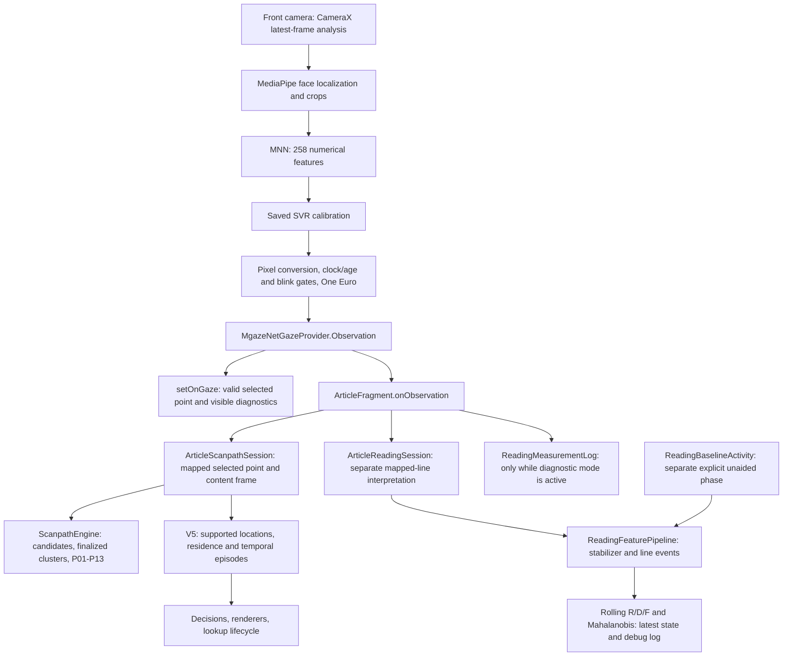

# Current input/output pipelines and local collection implementation

Source investigation: 2026-11-02, branch `feature/scanpath-mahalanobis-score`,
HEAD `3119cb9c6ccae4cbb7dcd7a45c1b1f56f2b1f535`.
The app/tools source has no working-tree changes at this checkpoint. This maps
the checked-out source, not the APK installed on a phone.

Initial study collection is **local recording followed by researcher transfer**.
Firebase Spark is the existing plan; a study cloud uploader is outside this
implementation. Mahalanobis remains observational. No algorithm, aid, camera,
device, schema or runtime changes were made during this investigation.

This implementation map supplements the [research/readiness plan](study-readiness-review-2026-11-02.md)
and the [draft record contract](study-data-framework.md). Proposed names below
are new work, not existing components.

## 1. Actual runtime path

The two uses of `ReadingFeaturePipeline` are separate instances. A baseline
profile is frozen in `ParticipantReadingBaseline` and later read by the article
scorer. Neither MD nor its features feed the V5 aid policy.

### Camera/provider boundary

[MgazeNetCameraSource.kt](../app/src/main/java/com/newsmead/gaze/mgazenet/MgazeNetCameraSource.kt)
requests approximately 640×480 front-camera analysis with `KEEP_ONLY_LATEST`.
Localization is serial on the camera executor; MNN/SVR inference uses its worker.
Two preprocessor slots bound queued/in-flight face work. Busy-slot rejections
are counted; frames discarded upstream by CameraX are not observable here.
The source requires the camera REALTIME clock to share Android elapsed time.
Compatibility also depends on saved acquisition shape/rotation/localizer identity,
not only Android version or the presence of a front camera.

[MgazeNetGazeProvider.kt:53](../app/src/main/java/com/newsmead/gaze/mgazenet/MgazeNetGazeProvider.kt#L53)
provides the collection boundary:

| Observation field | Actual meaning |
| --- | --- |
| `captureMs` | Camera capture timestamp on the verified shared elapsed clock; nullable for terminal stop. |
| `deliveryElapsedNs`, `outputMs` | Main-thread delivery time, in ns and converted ms respectively. |
| `deliveryId` | Incrementing delivery sequence, reset by provider start. It needs a separate provider-epoch ID. |
| `rawX/rawY` | Calibrated prediction multiplied by physical screen dimensions, before One Euro. These are not uncalibrated model outputs or images. |
| `x/y` | Selected calibrated/smoothed screen point, available when gates permit coordinate delivery. |
| `reason`, `timeoutWatchdog` | Coordinate or missing/invalid/stale/stop status. Watchdog stale delivery can repeat an earlier capture; it is not a new camera sample. |
| `arrivals`, `busyDrops` | Observed source counters; not total sensor frames. |
| Eye-aspect/blink fields | Current article/baseline request numerical blink telemetry. A blink reason is not a physiological blink-event count. |

`MgazeNetOutputGate` retains finite raw predictions even when a result is stale
or otherwise unusable; selected coordinates are withheld. Its expiry is 500 ms.
`MgazeNetLiveOutput` applies blink logic and One Euro with capture time; its
parameters are min cutoff 0.7 and beta 0.002. Preserve both coordinate streams,
nulls and status. Do not log only `GazeProvider.setOnGaze`: it delivers valid
coordinates only and omits timestamps, invalidity and counters.

Source-ready metadata currently terminates at the provider's `ready = {}`.
Detailed stage performance reaches aggregate `MGazeNetPerf` Logcat messages.
A small optional numerical metadata/health callback would be needed to retain
actual acquisition/delegate/requested-FPS information in a package; the current
Observation does not contain it. No feature arrays or camera images are needed.

### Article fan-out and different interpretations

[ArticleFragment.kt:1355](../app/src/main/java/com/newsmead/fragments/article/ArticleFragment.kt#L1355)
creates the provider, both adapters, the feature pipeline and the scorer.
Its [observation callback at 1430](../app/src/main/java/com/newsmead/fragments/article/ArticleFragment.kt#L1430)
is the proposed once-per-delivery recording point, before reasons are copied for
each consumer.

- Scanpath uses `ARTICLE_SMOOTHED`, `motionCompensatedAids=true`.
  `ArticleScanpathSession` saves selected screen points in `onInput`, while the
  engine clusters in body-content pixels. Finalized-fixation callbacks are
  projected back to the current screen frame. Preserve these frame differences.
  Callbacks already exist for geometry, input, candidate, fixation, event and
  detector acceptance. `onAcceptance` is currently not connected in the article.
- MD uses a separate `ArticleReadingSession`, `ARTICLE_SMOOTHED`, motion
  compensation false. Its sample passes mapped line/count, eligibility and
  capture time truncated to integer ms to `ReadingFeaturePipeline.sample`.
  Manual `reading_scroll` calls `breakContinuity`; other structural boundaries
  reset the rolling pipeline. Invalid/nonmonotonic cases have separate handling.
- Controls affect both paths. MD additionally receives exclusions during TTS,
  diagnostic recording and auto-scroll. Scanpath's content-motion route can
  continue through controlled translation. Thus one shared provider observation
  must retain **separate per-consumer sample/exclusion records**.

Geometry has a 150 ms capture-based settle guard. Scanpath's capture geometry
history has a 100 ms age limit and its motion input a 250 ms freshness limit;
provider acceptance therefore does not establish scanpath acceptance. IDs such
as `geometry:1`, native candidate IDs and generation counters are producer-local.
Scope them by visit, provider/adapter epoch, producer and generation.

### P01–P13 and V5 are different outputs

[ReadingAidPolicy.kt:105](../app/src/main/java/com/newsmead/gaze/aid/ReadingAidPolicy.kt#L105)
and its `onObservation` return after V5 preparation instead of entering the older
P-number-driven decisions. [prepareV5:561](../app/src/main/java/com/newsmead/gaze/aid/ReadingAidPolicy.kt#L561)
uses `ReadingLocationSupport`, bookmark and focus state. A P-number-to-aid join
cannot explain the present system.

`ArticleReadingAidRuntime` already offers constructor callbacks for decisions,
render receipts, completed focus episodes and lookup-offer events. The article
does not currently attach durable consumers to them. `configurationSnapshot()`
already exposes a substantial versioned configuration and should be reused.

What remains inaccessible to a full collector: pending location/word state,
all support revisions/invalidations, detailed rejected/expired episode state,
and one explicit evaluation status per component. `ReadingLocationSupport.update`
returns current visit, fresh flag, reread, completed word residence and search
witnesses, but candidate and pending-word clocks are private. Its word-residence
return occurs at the 1,000 ms offer qualification, not every residence update.
The existing focus diagnostic map supplies useful status/counts, not the entire
evidence history. Add immutable observational emissions at state changes and
before resets; do not infer unseen pending state from absence of an action.

`prepareV5` can exit before evaluation when preferences/geometry/operational
gates fail. Record `not_evaluated` and the actual gate. Existing aids-off does
not supply counterfactual V5 support/decisions. Shadow evaluation is separate work.

### Baseline and MD output

Home already launches `ReadingBaselineActivity` via `btnReadingBaseline`.
The activity has explicit participant-code entry, Start, and Finish-and-freeze.
It uses a fixed passage and no gaze-dot listener output or aid runtime.
At [collectTick:234](../app/src/main/java/com/newsmead/activities/ReadingBaselineActivity.kt#L234),
save every feature vector **before** `collector.add`, including rejected windows
and the retention result. At [finishAttempt:246](../app/src/main/java/com/newsmead/activities/ReadingBaselineActivity.kt#L246),
save successful and failed fits, configuration, means, covariance, regularized
covariance, sampling counts and factor diagnostics. Save start/interruption/failure
states too. The initial `pipeline.tick(startedAt)` matters for replay timing.

`ParticipantReadingBaseline.Entry` contains participant code, baseline-attempt
`sessionId`, calibration fingerprint and frozen profile. Its active identity is
in-memory and calibration-bound; it has no current typography/camera-policy key.
Process restart requires a new baseline. Persist the research artifact without
automatically restoring it as an active model after restart.

[ArticleFragment.kt:141](../app/src/main/java/com/newsmead/fragments/article/ArticleFragment.kt#L141)
is the existing 500 ms feature/score tick. Save the `RdfFeatureVector` and
`MahalanobisScore` there, with baseline reference/status. The debug snapshot
alone omits window boundaries/counts/configuration and masks feature values for
unusable windows. Its `AppLog.d` output is debug-only Logcat, not a study file.

R uses confirmed backward movements relative to line progression; F counts
300 ms line stays; D sums residence qualified at 120 ms. A 120 ms line stabilizer
precedes these events. R/F and D divide by the full rolling span. Quality includes
valid-sample fraction and first-to-last usable endpoint span, not valid-time
union. Windows nominally cover 10 seconds; updates occur every 500 ms. Baseline
requires 30 retained windows/60 seconds of their union, with `1e-6 I` covariance
regularization. Record actual clocks, boundaries and parameters, not just these
defaults. Exact offline replay requires tick times and boundary/reset order as
well as gaze samples.

## 2. Existing local storage: what to reuse

| Existing component | Useful foundation | Why it is insufficient unchanged |
| --- | --- | --- |
| `research/SessionLog.kt` | Background writer, bounded queue, JSONL, no-backup storage, completion/drop counts | Ordinary `appusage_` schema, no joint study IDs/manifests/recovery. `elapsed_ms` is relative to its private session start, unlike gaze's since-boot elapsed ms. |
| `research/ResearchSession.kt` | App/reading usage vocabulary and session reference | App foreground automatically starts it without attribution; participant/condition default to `unassigned`/`none`. Baseline code entry does not update this context. |
| `gaze/ReadingMeasurementLog.kt` | Numeric observation and line-geometry serialization, queued writer | Diagnostic mode suspends aids, stops TTS, forces dot-only display and changes camera policy. Raw mapping/geometry are a separate schema-1 instrument. No exact body text or study manifest. |
| `gaze/scanpath/audit/ScanpathTraceWriter.kt` | Typed native serialization and partial-to-final rename | Writes synchronously at callback sites, default cap 20,000, lacks current motion-compensation serialization and full package recovery. Preserve frozen pilot/replay contracts. |
| `gaze/aid/ReadingAidTrace.kt` | Rich action/evidence JSON, decision/render/interaction/configuration examples | 2,048-record memory ring, 512 support facts; revised facts overwrite earlier versions. Input context is not an appended record for every callback; only selected evidence survives. Manual save creates private JSON, not a transferred package. |
| `research/SessionLogExport.kt` | Explicit copy-to-cache/FileProvider share pattern | Deliberately selects only `appusage_*.jsonl`; no call site found. Selection excludes the current usage ID but does not verify writer closure or package integrity. Do not broaden the prefix to sweep all gaze files. |

The FileProvider is already declared in `AndroidManifest.xml`, with authority
`${applicationId}.research.fileprovider`, restricted to cache `research-export/`.
A dedicated selected-package exporter can stage there and share a completed ZIP,
or add a separate narrow cache path. It must await study-writer completion,
include referenced baseline/text/layout artifacts and verify its manifest. Keep
originals until the researcher verifies the received bytes. A share chooser
return is not a verified transfer receipt.

Reuse the mechanics and serializers selectively in a dedicated
`research/study/` collector. Reusing an existing diagnostic activity or increasing
a ring capacity would change the condition or still lose required history.
Keep the canonical study clock absolute Android elapsed ms. If usage logs are
included as ancillary files, save their clock origin explicitly or retain them
as a separate time domain; their existing `elapsed_ms` values cannot be joined
directly to capture times.

## 3. Current configuration mismatches to record or resolve

- Article requests stable 30/30 FPS when advertised; baseline uses provider's
  default request, and diagnostic recording explicitly restores that default.
  A request is not measured delivered cadence. Align baseline/article acquisition
  prospectively if chosen for the study, version it and recheck compatibility;
  do not silently alter frozen measurement conditions.
- Baseline uses 22 **dp**. Normal article uses adjustable 14–60 **sp**, default
  22 sp, system font scale, and 1.6 line spacing. `LOCK_ARTICLE_FONT_SIZE=false`.
  Save actual text pixels, density/font scale, spacing and full geometry in both.
- `GAZE_DEBUG_VISUALS=true`; the current reader displays dot/FPS. The owner
  previously required dot and interpretation to share selected coordinates.
  The final participant dot condition is still open; record and hold the chosen
  condition consistent. Do not assume hidden-dot study use was approved.
- `SCANPATH_READING_AIDS=true` bypasses legacy scaffold-controller decisions even
  though `SCAFFOLD_MODE=DEMO_CYCLE` remains in `StudyConfig`. That legacy value
  does not mean the current article is cycling its four old levels.
- `OFFLINE_MODE=false` means article acquisition still uses network paths.
  Local research storage does not require changing this. A bundled
  `study_articles.json` feed and local saved-article path exist if fixed offline
  material is selected later. Capture the final rendered body after
  `articleBodyReady`, and create new snapshots on translation/replacement.
  Extraction can fail and leave a summary as the final body; record that fallback
  rather than assuming readiness means full-article extraction. A URL or body
  hash alone cannot reconstruct the text.

## 4. Concrete implementation packages

The first integration can use these existing seams; only the last row needs
new evidence exposure inside the policies:

| Record group | Exact producer/hook | Existing hook or additional work |
| --- | --- | --- |
| Original observation, provider epoch and terminal receipt | `ArticleFragment.attachLiveGaze` / baseline `beginAttempt`, provider `onObservation` and `stopAndThen` | Existing callbacks; attach a recorder independently of adapter/lifecycle guards. |
| Per-consumer geometry, mapping, eligibility and accepted input | `ArticleScanpathSession` and `ArticleReadingSession` callbacks | Existing callbacks; connect Scanpath `onAcceptance`, and retain each adapter's boundaries and producer scope. |
| Native candidate/fixation/P01–P13 output | `ArticleScanpathSession.onCandidate/onFixation/onEvent` | Existing callbacks; stream updates including null candidate invalidation instead of saving a final count/cache. |
| Baseline attempt/window/fit and article MD | `ReadingBaselineActivity.collectTick/finishAttempt`, `ArticleFragment.mahalanobisTick` | Existing values; add immutable serialization, tick/boundary provenance and reference linkage. |
| Aid decision/draw/offer/completed focus episode/configuration | `ArticleReadingAidRuntime` constructor callbacks / `configurationSnapshot()` | Existing hooks; connect them and expose remaining trace-only lifecycle events. |
| Pending/revised/invalidated support and actual component evaluation | `prepareV5`, location/bookmark/focus state transitions and reset points | New observational hooks required. Preserve gates and calculations unchanged. |

1. **Contract and local core.** Extend the draft into a separately versioned
   contract; keep v0.1 examples intact. Add baseline phase/attempt/model,
   MD feature/score and per-producer interpretation records. Introduce a small
   study-run context with participant code, run ID, condition and phase; retain
   article-visit IDs and baseline-attempt IDs as distinct. Create immutable events,
   a serial bounded background writer, manifest/finalization/recovery and a
   dedicated exporter. File open/serialization/hash work should run on the writer,
   not the UI or inference path. On recorder failure, surface failure and preserve
   aid behavior. Declare losses/durability; never silently replace earlier rows.
   Record both the study participant and the baseline entry's participant code;
   explicitly flag a mismatch and exclude that reference from attributed study
   MD analysis. Starting a new participant must not silently inherit the old
   reference. Changing runtime profile eligibility is a separate decision; this
   recording change must preserve the actual emitted output and its provenance.
2. **Baseline and article taps.** Own edits to `ReadingBaselineActivity.kt` and
   `ArticleFragment.kt` together. Capture original provider observations before
   exclusions; then each adapter's input/acceptance and native output. Record all
   feature ticks, reset/break calls, baseline outcomes and complete score objects.
   Reuse runtime decision/render/offer/episode callbacks and configuration
   snapshots. Save exact text, row/word geometry and viewport origins. Do not
   change how raw/selected input is chosen or add another smoothing filter.
3. **V5 observational emissions.** Instrument `ReadingAidPolicy.kt`,
   `ReadingLocationSupport.kt`, `ReadingBookmarkPolicy.kt`, `ReadingFocusPolicy.kt`
   and `ArticleReadingAidRuntime.kt` for support revisions, pending/closed state,
   actual evaluation/gates and invalidation before reset. Connect existing trace-only
   lifecycle events, including consultation/control/auto-scroll and held-focus
   presentation. Add stable presentation IDs: many refreshed action IDs can form
   one continuous display. Do not equate a draw callback with human exposure.
4. **Import and analysis.** Build a package validator and normalized tables for
   visits, observations, per-producer mappings, baseline/windows/scores,
   support/evaluations/decisions/presentations, interactions and losses. The current
   `analyze_reading_measurement.py` accepts schema-1 raw diagnostic logs;
   `summarize_scanpath_pilot.py` accepts its own pilot schemas. Neither is a joint
   study importer. Reuse extraction/replay functions through an explicit adapter
   where contracts match; preserve historical meanings and add parity fixtures.
   Retained raw/selected trajectories permit the proposed second observational
   measure offline, without modifying aids or adding runtime workload now.

### Shutdown is a required integration case

Article `onPause` suspends aid/adapter interpretation and stops feature ticks;
`onStop`/`onDestroyView` close logical sessions before asynchronous provider close.
The provider emits `stopped` with final counters only after close completes.
Baseline similarly sets `running=false` before closing its provider, so its
current gated callback does not pass that terminal observation into the adapter.

Capture the collector and provider-epoch identity in each provider callback's
closure. Collect original/terminal observations independently of the current
fragment/session guard and never use destroyed Views to serialize them. Close the
study's logical reading interval at the lifecycle boundary; keep its writer alive
until the old provider's final counters/close receipt and queue drain complete.
Only then publish the final package. If interrupted, preserve an incomplete tail.
An old provider must not finalize or append into a newer provider's package.
Do not manufacture reading time or samples during this closing interval.

Use a declared bounded wait for provider close. If the receipt never arrives,
seal the recoverable prefix with an incomplete/censored provider epoch and
unknown terminal counters. Later receipts, if retained, belong in a separately
linked receipt artifact; do not append into an already finalized/hashed chunk.
Neither timeout nor a late receipt extends the logical reading interval.

## 5. Acceptance checks tied to these seams

- Fixed replay inputs produce identical aid decisions/actions with recording
  disabled/enabled, unavailable/extreme MD and recorder I/O failure. MD remains
  disconnected from controller eligibility, strength and timing.
- Each provider delivery, including invalid/stale/watchdog/stopped, is reconciled
  by `(provider_epoch, delivery_id)` with retained/dropped records. Preserve the
  difference between provider deliveries, fresh captures and CameraX losses.
- A single observation can have accepted Scanpath input and excluded MD input;
  producer scope, content/screen coordinates and capture/delivery clocks survive
  export/import. Record candidate clearing as well as non-null revisions.
- Baseline fixture replay includes actual tick/boundary order and reproduces
  retained windows, fit/failed-fit metadata and MD; process restart leaves active
  MD unavailable under current semantics even though research artifacts survive.
- A new study participant with an older active baseline produces explicit
  participant/reference mismatch provenance, never a silently attributed score.
- Include no-trigger, pending, gated, qualified-but-not-drawn, lookup
  accept/dismiss/expire and repeated action-refresh cases. Disabled routes must
  remain `not_evaluated`, not fabricated negative qualifications.
- Exercise old-provider close after replacement, missing/late close receipt,
  bounded shutdown, background/rotation, queue
  overflow, storage error, process death/reboot, truncated final line and interrupted
  export. Validate references/counts/hashes and unknown endings. Preserve failures.
- Declare overhead, allowed loss/durability and usable-coverage budgets before
  accepting a phone rehearsal. Measure them in ordinary reading with collection
  active; requested FPS and synthetic rendering checks cannot supply this result.

Existing relevant fixtures include `ReadingFeaturePipelineTest`,
`ParticipantReadingBaselineTest`, `MahalanobisCoreTest`,
`SmoothedScanpathSessionTest`, `ScanpathMotionCompensationTest`,
`ReadingLocationSupportTest`, policy/trace tests and the 34-record draft checker.
No unchanged test suite was rerun for this documentation-only investigation.
Earlier passing checks remain software evidence, not participant readiness.

## 6. Historical context checked

Read recent discussion in **Review landed gaze metrics proposal (3)** and asked
that chat for a bounded historical handoff. It confirmed selected-stream
consistency as an owner decision, distinguished proposed collector emissions
from implemented trace behavior, and could not substantiate final participant
dot settings or adoption of particular readiness/focus restrictions. These
proposals are not silently adopted here. Source above takes precedence over
historical summaries. The earlier Firebase chat was reviewed in the preceding
readiness assessment.

Remaining study choices are participant age definition, phone route, dot and
typography/acquisition conditions, materials/outcomes, sample size/duration and
retention. They do not prevent implementing the local record backbone. This
investigation does not install a build, start capture, inspect private recordings,
change Firebase, stage or commit files.
